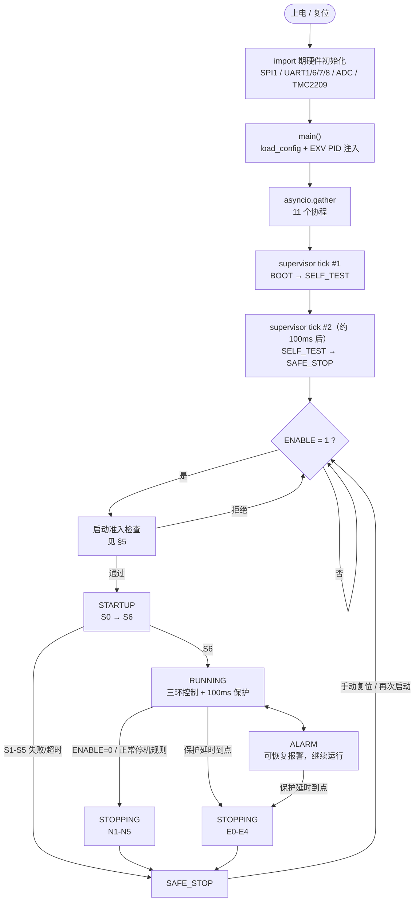
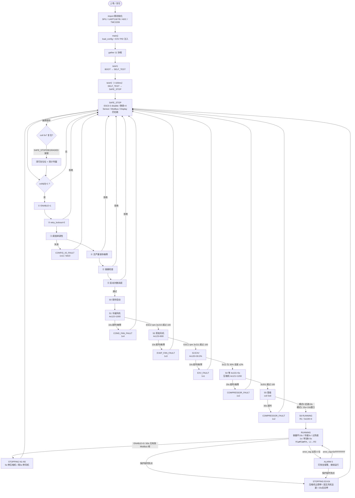

# Refrigerate_System
**_Please ensure your personal safety!!!_ and then ensure compressor safety**>_<

The open source refrigeration (heat pump) system

In this project, I will use STM32 + Raspberry PICO2(for motor driver) + Micropython to design. Because I am not an all-round talent. Some work will be done by AI. Thanks to Ms.Claude, ChatGPT, Kimi & Deepseek.

Mainflow:

All Process Mainflow:

**All codes & Refrigeration designs will be open source!**

**Let everyone make the air conditioner they want.** I believe that open source can lead to progress.

The code is being updated
