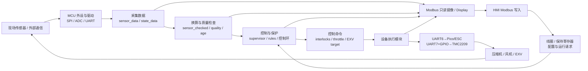

# 硬件 I/O 与信号映射

**用途**：集中说明现场传感器、MCU 外设、软件数据、控制消费者、执行器和 HMI 点位之间的对应关系。本文相当于 PLC 项目的物理 I/O 表，但本项目采用 STM32 + MicroPython + 并行协程，信号经 `Board/state.py` 共享，不存在统一的 PLC `I/Q` 地址区。

**核对基准**：2026-11-05 当前工作区。代码配置优先于注释；有冲突或尚未实物确认的内容会明确标注。Modbus 全量地址和倍率以 [`MODBUS_POINT_TABLE.md`](MODBUS_POINT_TABLE.md) / [`MODBUS_POINT_TABLE.csv`](MODBUS_POINT_TABLE.csv) 为准。

## 1. 信息流总览



## 2. 硬件资源与物理接口

| 信号/设备 | MCU 外设与引脚 | 方向 | 软件入口/出口 | 状态 |
|---|---|---|---|---|
| AD7124，5 路 PT100 | SPI1，500 kHz，CS=PG15 | 输入 | `Sensor/read_sensors.py` → `sensor_data[0..4]` | 运行时由 `board.AD7124_spi` / `board.AD7124_cs` 提供总线；AD7124 惰性初始化 |
| PT100 通道配置 | AD7124 CH0_MAP…CH4_MAP 依次配置 | 输入 | `AD7124.config_pt100_chs_async()` 返回 5 个值，按顺序写入索引 0…4 | 软件顺序明确；传感器到 AD7124 AIN 端子的实物接线表尚需台架/原理图确认 |
| 吸气压力 | PC2，`adc_direct.read_pc2_c`，滑动均值窗口 16 | 输入 | `psi_trans()` → `sensor_data[5]` / `IDX_SUCTION_PSI` | 软件单位为绝压 bara |
| 排气压力 | PC3，`adc_direct.read_pc3_c`，滑动均值窗口 16 | 输入 | `psi_trans()` → `sensor_data[6]` / `IDX_DISCHARGE_PSI` | 软件单位为绝压 bara |
| 整机电流 | PA4，`pyb.ADC` | 输入 | `read_current(..., bits=12)` → `sensor_data[9]` / `IDX_CURRENT` | 代码主采样通道 |
| 备用电流 | PA5，`pyb.ADC` | 输入 | `board.adc_backup` | 资源已创建；当前 `reads_async()` 未采样该通道 |
| 流量开关 | 当前无已确认 MCU 引脚 | 输入 | `board.di_flow` → `state_data[ST_FLOW_SWITCH]` | 软件占位，不是实体 DI；`FLOW_ENABLE` 当前应保持 0 |
| Pico / ESC 通信 | UART6，921600 baud | 双向 | `HAL/Driver.py`、`main.DriverLink()` | 命令帧 `0xA5`，状态帧 `0x5A`；MCU 到 Pico 的 UART 引脚复用/接插件脚位需以目标板原理图确认 |
| EXV 步进脉冲 | TIM4 CH2 → PD13 (STEP) | 输出 | `EXV/TMC2209.py` | 运行代码配置；STEP 脉冲频率/步数由 EXV 驱动层控制 |
| EXV 方向/使能 | PE10 (DIR)、PE12 (EN) | 输出 | `EXV/EXV.py` 创建 TMC2209 实例 | DIR：1 开阀、0 关阀；EN：低有效 |
| TMC2209 单线 UART | UART7，115200 baud；PE7/PE8 (TX/RX) | 双向 | `EXV/TMC2209.py` | TX/RX 通过 1kΩ 电阻连接实现单线半双工 |
| HMI Modbus RTU | UART8，9600、8N1、RS485 转接板 | 双向 | `Display_Touch/modbus_slave.py` | 当前 `DE_PIN=None`，方向切换由转接板自动处理 |
| 测试显示屏 | UART1，115200 | 输出 | `Display_Touch/Display.py` | 测试屏协议；不是正式 Modbus HMI 通道 |

### 2.1 配置说明与注意事项

- **TMC2209 接线注释**：`EXV/TMC2209.py` 文件头已按运行配置更新为 PD13/PE10/PE12、UART7 和 PE7/PE8；运行时实例参数定义在 `EXV/EXV.py`。
- **AD7124 运行配置**：主程序通过 `board.py` 使用 PG15 作为 CS。独立测试入口中的 PA4 配置只用于单独运行该测试文件，不影响正常 `main.py` 运行。
- UART6 到 Pico 的连接器脚位、RS485 端子/线束编号及各传感器的实际端子编号，应以目标板原理图和线束图补齐。

## 3. 传感器输入到软件数据的映射

| 序号 | 物理量 | 采集来源 | 原始软件数据 | 质量/控制数据 | 单位与说明 | 主要消费者 | 对外点位 |
|---:|---|---|---|---|---|---|---|
| 0 | 压缩机吸气温度 | AD7124 PT100 返回值 0 | `sensor_data[0]` | `sensor_checked[0]` | °C | 过热度计算、规则保护 | 3x1，×100 |
| 1 | 排气温度 | AD7124 PT100 返回值 1 | `sensor_data[1]` | `sensor_checked[1]` | °C | 排气温度保护 | 3x2，×100 |
| 2 | 蒸发器入口空气温度 | AD7124 PT100 返回值 2 | `sensor_data[2]` | `sensor_checked[2]` | °C | 显示/监控 | 3x3，×100 |
| 3 | 蒸发器出口空气温度 | AD7124 PT100 返回值 3 | `sensor_data[3]` | `sensor_checked[3]` | °C；容量环被控量 | `Compressor` 容量环、温控子状态 | 3x4，×100 |
| 4 | 制冷剂液管温度 | AD7124 PT100 返回值 4 | `sensor_data[4]` | `sensor_checked[4]` | °C | 过冷度/液管焓计算 | 3x5，×100 |
| 5 | 吸气压力 | PC2 ADC | `sensor_data[5]` | `sensor_checked[5]` | bara；包括表压到绝压换算 | 过热度计算、低压规则 | 3x7，×100 |
| 6 | 排气压力 | PC3 ADC | `sensor_data[6]` | `sensor_checked[6]` | bara；包括表压到绝压换算 | `Condenser` 压力环、高压规则、过冷度/焓计算 | 3x6，×100 |
| 7 | 过热度 SH | 吸气温度与吸气压力派生 | `sensor_data[7]` | `sensor_checked[7]` | K；`吸气温度 - 吸气压力对应饱和温度` | EXV PID、低过热度保护 | 3x8，×10 |
| 8 | 吸气焓 E | 吸气温度与吸气压力查表 | `sensor_data[8]` | `sensor_checked[8]` | kJ/kg | 当前主要用于显示 | 3x10，×100 |
| 9 | 整机电流 | PA4 ADC | `sensor_data[9]` | `sensor_checked[9]` | A | 过流保护 | 3x14，×10 |
| — | 过冷度 SC | 排气压力与液管温度派生 | `state.subcooling` | 当前不在 sensor quality/age 体系内 | K | 当前显示/监控 | 3x9，×10 |
| — | 液管焓 | 排气压力与液管温度查表 | `state.liquid_enthalpy` | 当前不在 sensor quality/age 体系内 | kJ/kg | 当前显示/监控 | 3x11，×100 |

**数据约定**：`sensor_data[]` 是显示/诊断通道；控制逻辑必须在检查 `sensor_quality == Q_OK` 和 `sensor_age_ms()` 后使用 `sensor_checked[]`。无效值 `999` 是哨兵，不代表真实物理读数。

## 4. 执行输出与反馈映射

### 4.1 ESC 通道

| 通道 ID | 设备 | 软件命令来源 | 物理通信出口 | 反馈软件地址 | Modbus 反馈 |
|---:|---|---|---|---|---|
| 0 | 压缩机 | `supervisor_interlocks` → `Compressor`；容量环基础输出 + 可选转速环 | UART6 → Pico → ESC0 | `state_data[16..19]`；`ST_MOTOR_SPEED` 镜像 RPM | 3x200 油门、3x201 RPM、3x207…210 ESC 遥测 |
| 1 | 蒸发风机 | `Evaporator`；用户设定油门 + 可选转速环 | UART6 → Pico → ESC1 | `state_data[20..23]`；`ST_EVAP_FAN_RPM` | 3x202 油门、3x203 RPM、3x211…214 遥测 |
| 2 | 冷凝风机 | `supervisor_interlocks` → `Condenser`；压力环基础输出 + 可选转速环 | UART6 → Pico → ESC2 | `state_data[24..27]`；`ST_COND_FAN_RPM` | 3x204 油门、3x205 RPM、3x215…218 遥测 |
| 3 | 备用 ESC | 当前无设备控制消费者 | UART6 → Pico → ESC3 | `state_data[28..31]` | 3x219…222 遥测 |

**协议/量程**：每个命令包含设备 ID、使能位和油门；运行油门范围 48…2047，0 表示停机/无油门。H743 发送 5-byte `0xA5` 命令帧，Pico 返回 13-byte `0x5A` 状态帧。状态帧中的 eRPM 由 Driver 按电机极对数换算为 RPM；链路无效时遥测写 `999`。

### 4.2 EXV 通道

```text
过热度/启动阶段/手动设定
  → EXV/Valve_CRTL.py（目标或 PID 增量）
  → EXV/EXV.py（百分比 ↔ 0…500 步）
  → TMC2209：UART7 配置驱动，TIM4_CH2/PD13 输出 STEP，PE10 输出 DIR，PE12 输出 EN
  → 步进阀
  → 软件位置估算 state_data[ST_VALVE_POS / ST_VALVE_POS_STEPS]
  → Modbus 3x12 当前开度、3x13 目标开度
```

当前位置是依据归零和已执行步数的软件估算，不是独立位置传感器的实测反馈。阀门驱动故障事件写入 `ST_VALVE_FAULT`，由 `Alarm` 规则消费。

### 4.3 系统级联锁到设备输出

| 联锁字段 | 消费者 | 最终影响 |
|---|---|---|
| `comp_enable` / `comp_throttle_cmd` | `Compressor` | ESC0 使能与油门命令 |
| `evap_fan_enable` / `evap_fan_throttle_cmd` | `Evaporator` | ESC1 使能与运行命令；RUNNING 时用户油门设定按当前设计生效 |
| `cond_fan_enable` / `cond_fan_throttle_cmd` | `Condenser` | ESC2 使能与油门命令；保护动作可覆盖为全速 |
| `exv_enable` / `exv_target_pct` | `Valve_CRTL` / `EXV` | EXV 定位、过热度调节或关阀目标 |

联锁由 `supervisor` 写入；设备模块消费并实际下发。保护规则可生成 `limit_actions`，影响降容、禁止升速、强制风机、缩小 EXV 或停机。

## 5. 软件数据面完整索引

### 5.1 `state_data[0..33]`

| 索引 | 符号 | 映射含义 | 写入/来源 | 对外状态点 |
|---:|---|---|---|---|
| 0 | `ST_MOTOR_SPEED` | 压缩机 RPM 反馈镜像 | `Compressor` 从 ESC0 RPM 更新 | 3x201 |
| 1 | `ST_VALVE_POS` | EXV 当前开度 % | `Valve_CRTL` / `EXV` | 3x12 |
| 2 | `ST_VALVE_POS_STEPS` | EXV 位置估算步数，0…500 | `EXV` | 当前未单独映射为 Modbus 点 |
| 3 | `ST_VALVE_FAULT` | EXV 故障事件位 | `EXV`，supervisor 消费 | 汇总进 `error_reg` / 1x1 |
| 4 | `ST_EVAP_FAN_SPEED_CMD` | 蒸发风机用户油门设定镜像 | Modbus / 用户参数 | 参数对应 4x222 |
| 5 | `ST_EVAP_FAN_RPM` | 蒸发风机 RPM 反馈 | `Evaporator` | 3x203 |
| 6 | `ST_EVAP_FAN_FAULT` | 蒸发风机故障事件位 | `Evaporator`，supervisor 消费 | 汇总进 `error_reg` / 1x3 |
| 7 | `ST_COND_FAN_SPEED_CMD` | 冷凝风机命令镜像 | `Condenser` | 3x204 为当前输出镜像 |
| 8 | `ST_COND_FAN_RPM` | 冷凝风机 RPM 反馈 | `Condenser` | 3x205 |
| 9 | `ST_COND_FAN_FAULT` | 冷凝风机故障事件位 | `Condenser`，supervisor 消费 | 汇总进 `error_reg` / 1x4 |
| 10 | `ST_SENSOR_FAULT` | 传感器故障汇总状态 | supervisor / Sensor 状态逻辑 | 只读状态；具体通道看 `sensor_fault_reg` |
| 11 | `ST_SYSTEM_ENABLE` | 系统使能 | Modbus coil 0x1 → `state` | 0x1、1x101 等相关状态 |
| 12 | `ST_MOTOR_SPEED_MIN` | 压缩机最低转速限制 | `state` 参数 / Modbus | 参数索引见保持寄存器表 |
| 13 | `ST_MOTOR_SPEED_MAX` | 压缩机最高转速限制 | `state` 参数 / Modbus | 参数索引见保持寄存器表 |
| 14 | `ST_FAN_SPEED_MIN` | 风机最低转速限制 | `state` 参数 / Modbus | 参数索引见保持寄存器表 |
| 15 | `ST_FAN_SPEED_MAX` | 风机最高转速限制 | `state` 参数 / Modbus | 参数索引见保持寄存器表 |
| 16…19 | `ST_ESC0_*` | 压缩机 ESC RPM/温度/电压/电流 | `DriverLink` 遥测 | 3x207…3x210 |
| 20…23 | `ST_ESC1_*` | 蒸发风机 ESC RPM/温度/电压/电流 | `DriverLink` 遥测 | 3x211…3x214 |
| 24…27 | `ST_ESC2_*` | 冷凝风机 ESC RPM/温度/电压/电流 | `DriverLink` 遥测 | 3x215…3x218 |
| 28…31 | `ST_ESC3_*` | 备用 ESC RPM/温度/电压/电流 | `DriverLink` 遥测 | 3x219…3x222 |
| 32 | `ST_FLOW_SWITCH` | 流量开关状态 | 当前 `board.di_flow` 软件占位 | 功能预留；不可视为实体 DI |
| 33 | `ST_COMPRESSOR_FAULT` | 压缩机故障事件位 | `Compressor`，supervisor 消费 | 汇总进 `error_reg` / 1x2 |

ESC 遥测的电压/电流缩放、无效值和协议字段见本文件 §7；数组索引常量以 `Board/state.py` 为代码定义。

### 5.2 故障位与保护事件

`sensor_fault_reg` 采用 **1=正常、0=异常**，对应直接测量传感器：

| 位 | 故障符号 | 传感器/软件索引 |
|---:|---|---|
| 0…4 | `SUCTION_T_FAULT`…`LIQUID_T_FAULT` | `sensor_data[0…4]`：5 路 PT100 |
| 5 | `SUCTION_PSI_FAULT` | `sensor_data[5]` |
| 6 | `DISCHARGE_PSI_FAULT` | `sensor_data[6]` |
| 7 | `CURRENT_FAULT` | `sensor_data[9]` |

系统级 `error_reg` 也是 **1=正常、0=故障**；`Alarm/supervisor.py` 是唯一写者。各位对外镜像到 1x 离散输入：

| 位 / 点位 | 故障符号 | 位 / 点位 | 故障符号 |
|---|---|---|---|
| bit0 / 1x1 | `EXV_FAULT` | bit8 / 1x9 | `MODBUS_COMM_FAULT` |
| bit1 / 1x2 | `COMPRESSOR_FAULT` | bit9 / 1x10 | `LOW_SUPERHEAT_FAULT` |
| bit2 / 1x3 | `EVAP_FAN_FAULT` | bit10 / 1x11 | `CONFIG_IO_FAULT` |
| bit3 / 1x4 | `COND_FAN_FAULT` | bit11 / 1x12 | `SUCTION_PSI_FAULT` |
| bit4 / 1x5 | `HIGH_PRESSURE_FAULT` | bit12 / 1x13 | `DISCHARGE_PSI_FAULT` |
| bit5 / 1x6 | `LOW_PRESSURE_FAULT` | bit13 / 1x14 | `CURRENT_SENSOR_FAULT` |
| bit6 / 1x7 | `HIGH_DISCHARGE_TEMP` | bit14 / 1x15 | `SENSOR_STALE_FAULT` |
| bit7 / 1x8 | `OVERCURRENT_FAULT` | bit15 / 1x16 | `FLOW_FAULT`（当前预留） |

Driver 链路、联锁和重试状态另映射到 1x100…1x105，不占用上述故障位。`error_reg` 的 32 位高低字镜像分别在 3x110、3x111。

### 5.3 supervisor 联锁与动作码

| 软件字段/位 | 含义 | 消费者/外部镜像 |
|---|---|---|
| `supervisor_interlocks.comp_enable` | 压缩机使能门禁 | `Compressor`；1x101 |
| `supervisor_interlocks.comp_throttle_cmd` | 压缩机油门命令 | `Compressor` → ESC0 |
| `supervisor_interlocks.evap_fan_enable` | 蒸发风机使能门禁 | `Evaporator`；1x102 |
| `supervisor_interlocks.evap_fan_throttle_cmd` | 蒸发风机命令字段 | `Evaporator` → ESC1；运行期用户油门口径见 4x222 |
| `supervisor_interlocks.cond_fan_enable` | 冷凝风机使能门禁 | `Condenser`；1x103 |
| `supervisor_interlocks.cond_fan_throttle_cmd` | 冷凝风机油门命令 | `Condenser` → ESC2 |
| `supervisor_interlocks.exv_enable` | EXV 使能门禁 | `Valve_CRTL` / `EXV`；1x104 |
| `supervisor_interlocks.exv_target_pct` | EXV 目标开度 % | `Valve_CRTL` / `EXV`；3x13 |

`limit_actions` 映射到 3x223，是组合位图：`0x01` 禁止升速、`0x02` 降容、`0x04` 冷凝风机全速、`0x08` EXV 关小、`0x10` 正常停机、`0x20` 故障安全停机。

## 6. HMI/Modbus 映射边界

UART8 Modbus 是**HMI 与控制软件之间的数据接口**，不是 MCU 现场 I/O 地址区：

| Modbus 区 | 数据方向 | 项目用途 |
|---|---|---|
| Coils `0x1…0x8` | HMI → 控制 | 系统使能、手动模式、转速环开关、复位脉冲、启动晋级模式 |
| Holding Registers `4x` | HMI ↔ 控制参数 | PID、保护阈值、延时、启动参数、手动设定 |
| Input Registers `3x` | 控制 → HMI | 传感器、控制状态、执行器输出和 ESC 遥测镜像 |
| Discrete Inputs `1x` | 控制 → HMI | 故障位、Driver 链路、使能联锁、重试锁定 |

Modbus 报文地址为 0 基代码索引，屏幕显示地址为索引 + 1。完整点位、倍率、权限和保留区见 [`MODBUS_POINT_TABLE.md`](MODBUS_POINT_TABLE.md)。

## 7. Modbus 四区完整点位表

本节将 HMI/上位机与固件之间的全部 Modbus 映射集中在本文件，包含连接参数、地址换算、权限、单位、倍率、功能说明和保留点。修改映射时以本节为人类可读主表，并同步维护 `MODBUS_POINT_TABLE.csv` 机器可读镜像。当前样机为风冷式直膨系统，流量相关点位仅为后续带水回路预留。

### 7.1 Modbus 连接参数

| 参数 | 值 |
|---|---|
| 波特率 | 9600 |
| 数据位 | 8 |
| 停止位 | 1 |
| 校验 | None |
| 从机地址 | 1（可配置） |
| 接口 | UART8, RS485 |

**地址约定**：报文地址 = 代码索引（0 基，标准 Modbus）；屏上显示地址 = 代码索引 + 1。
例如 4x1 对应报文地址 0、`hr[0]`。

> **消费者说明**：本表中部分点位**仅用于人机交互显示**（如 ESC 遥测、系统状态/联锁镜像、
> 过冷度、进出口焓等），由固件单向发布供触摸屏/上位机读取，代码内无消费者属正常设计，
> 并非缺陷或死点位（DESIGN.md §4.1 显示专用点位原则）。

> **样机范围**：当前样机为风冷式直膨制冷，蒸发侧没有水/载冷剂回路。4x6 `FLOW_ENABLE`、1x16 `FLOW_FAULT` 为后续带水回路版本预留；当前固件的 `di_flow` 是软件占位，不是实体输入。当前样机须保持 `FLOW_ENABLE=0`，不得将该点位描述为已具备实物流量保护。

---

### 7.2 Coils（0x，FC01/05/0F）

| 显示地址 | 代码索引 | 名称 | 符号 | 读写 | 单位 | 倍率 | 说明 |
|---:|---|---|---|---|---|---|---|
| 1 | `coils[0]` | 系统使能开关 | `SYSTEM_ENABLE` | R/W | - | 1 | 0=停机 1=运行 |
| 2 | `coils[1]` | 手动模式使能 | `MANUAL_MODE_ENABLE` | R/W | - | 1 | 0=自动 1=手动 |
| 3 | `coils[2]` | 压缩机转速环使能 | `COMP_SPEED_LOOP_ENABLE` | R/W | - | 1 | 0=禁用 1=启用 |
| 4 | `coils[3]` | 冷凝风机转速环使能 | `COND_FAN_SPEED_LOOP_ENABLE` | R/W | - | 1 | 0=禁用 1=启用 |
| 5 | `coils[4]` | 蒸发风机转速环使能 | `EVAP_FAN_SPEED_LOOP_ENABLE` | R/W | - | 1 | 0=禁用 1=启用 |
| 6 | `coils[5]` | 流量检查使能（后续带水回路版本） | `FLOW_ENABLE` | R/W | - | 1 | 当前样机保持 0；实体 DI 接入后方可启用 |
| 7 | `coils[6]` | 故障复位 | `FAULT_RESET` | W | - | 1 | 写1脉冲复位，回读恒0 |
| 8 | `coils[7]` | 晋级模式切换 | `STARTUP_ADVANCE_MODE` | R/W | - | 1 | 0=定速保持 1=转速稳定性 |

---

### 7.3 Discrete Inputs（1x，FC02，只读，1=正常 0=故障）

| 显示地址 | 代码索引 | 名称 | 符号 | 读写 | 单位 | 倍率 | 说明 |
|---:|---|---|---|---|---|---|---|
| 1 | `di[0]` | EXV故障 | `EXV_FAULT` | R | - | 1 | 1=正常 0=故障 |
| 2 | `di[1]` | 压缩机故障 | `COMPRESSOR_FAULT` | R | - | 1 | 1=正常 0=故障 |
| 3 | `di[2]` | 蒸发风机故障 | `EVAP_FAN_FAULT` | R | - | 1 | 1=正常 0=故障 |
| 4 | `di[3]` | 冷凝风机故障 | `COND_FAN_FAULT` | R | - | 1 | 1=正常 0=故障 |
| 5 | `di[4]` | 高压保护 | `HIGH_PRESSURE_FAULT` | R | - | 1 | 1=正常 0=故障 |
| 6 | `di[5]` | 低压保护 | `LOW_PRESSURE_FAULT` | R | - | 1 | 1=正常 0=故障 |
| 7 | `di[6]` | 排气温度保护 | `HIGH_DISCHARGE_TEMP` | R | - | 1 | 1=正常 0=故障 |
| 8 | `di[7]` | 过流保护 | `OVERCURRENT_FAULT` | R | - | 1 | 1=正常 0=故障 |
| 9 | `di[8]` | Modbus通讯故障 | `MODBUS_COMM_FAULT` | R | - | 1 | 1=正常 0=故障 |
| 10 | `di[9]` | 低过热度保护 | `LOW_SUPERHEAT_FAULT` | R | - | 1 | 1=正常 0=故障 |
| 11 | `di[10]` | 配置IO故障 | `CONFIG_IO_FAULT` | R | - | 1 | 1=正常 0=故障 |
| 12 | `di[11]` | 吸气压力传感器故障 | `SUCTION_PSI_FAULT` | R | - | 1 | 1=正常 0=故障 |
| 13 | `di[12]` | 排气压力传感器故障 | `DISCHARGE_PSI_FAULT` | R | - | 1 | 1=正常 0=故障 |
| 14 | `di[13]` | 电流传感器故障 | `CURRENT_SENSOR_FAULT` | R | - | 1 | 1=正常 0=故障 |
| 15 | `di[14]` | 传感器超龄故障 | `SENSOR_STALE_FAULT` | R | - | 1 | 1=正常 0=故障 |
| 16 | `di[15]` | 流量保护（后续带水回路版本） | `FLOW_FAULT` | R | - | 1 | 当前为预留状态；软件占位值不代表实体流量 |
| 100 | `di[99]` | Driver链路状态 | `DRIVER_LINK_OK` | R | - | 1 | 0=断开 1=正常 |
| 101 | `di[100]` | 压缩机使能联锁 | `COMP_ENABLE` | R | - | 1 |  |
| 102 | `di[101]` | 蒸发风机使能联锁 | `EVAP_FAN_ENABLE` | R | - | 1 |  |
| 103 | `di[102]` | 冷凝风机使能联锁 | `COND_FAN_ENABLE` | R | - | 1 |  |
| 104 | `di[103]` | EXV使能联锁 | `EXV_ENABLE` | R | - | 1 |  |
| 105 | `di[104]` | 重试锁定标志 | `RETRY_LOCKOUT` | R | - | 1 |  |
| 106 | `di[105]` | 保留_0 | `-` | R | - | 1 |  |
| 107 | `di[106]` | 保留_1 | `-` | R | - | 1 |  |
| 108 | `di[107]` | 保留_2 | `-` | R | - | 1 |  |
| 109 | `di[108]` | 保留_3 | `-` | R | - | 1 |  |
| 110 | `di[109]` | 保留_4 | `-` | R | - | 1 |  |
| 111 | `di[110]` | 保留_5 | `-` | R | - | 1 |  |
| 112 | `di[111]` | 保留_6 | `-` | R | - | 1 |  |
| 113 | `di[112]` | 保留_7 | `-` | R | - | 1 |  |
| 114 | `di[113]` | 保留_8 | `-` | R | - | 1 |  |
| 115 | `di[114]` | 保留_9 | `-` | R | - | 1 |  |

---

### 7.4 Holding Registers（4x，FC03/06/10）

| 显示地址 | 代码索引 | 名称 | 符号 | 读写 | 单位 | 倍率 | 说明 |
|---:|---|---|---|---|---|---|---|
| 1 | `hr[0]` | 过热度PID_Kp | `SH_PID_KP` | R/W | - | 100 | Kp=寄存器/100 |
| 2 | `hr[1]` | 过热度PID_Ki | `SH_PID_KI` | R/W | - | 100 | Ki=寄存器/100 |
| 3 | `hr[2]` | 过热度PID_Kd | `SH_PID_KD` | R/W | - | 100 | Kd=寄存器/100 |
| 4 | `hr[3]` | 过热度设定值 | `SH_SETPOINT` | R/W | K | 10 |  |
| 5 | `hr[4]` | 过热度误差阈值 | `SH_ERROR_THRESHOLD` | R/W | K | 10 |  |
| 6 | `hr[5]` | 过热度死区 | `SH_DEADBAND` | R/W | K | 10 |  |
| 7 | `hr[6]` | 过热度最大变化量 | `SH_MAX_DELTA` | R/W | - | 1 | EXV单次最大变化 |
| 8 | `hr[7]` | 保留 | `-` | - | - | - |  |
| 16 | `hr[15]` | 容量环PID_Kp | `CAP_PID_KP` | R/W | - | 100 |  |
| 17 | `hr[16]` | 容量环PID_Ki | `CAP_PID_KI` | R/W | - | 100 |  |
| 18 | `hr[17]` | 容量环PID_Kd | `CAP_PID_KD` | R/W | - | 100 |  |
| 19 | `hr[18]` | 容量环设定温度 | `CAP_SETPOINT` | R/W | °C | 100 |  |
| 20 | `hr[19]` | 容量环死区 | `CAP_DEADBAND` | R/W | K | 10 |  |
| 21 | `hr[20]` | 容量环最小油门 | `CAP_THROTTLE_MIN` | R/W | - | 1 | 48-2047 |
| 22 | `hr[21]` | 容量环最大油门 | `CAP_THROTTLE_MAX` | R/W | - | 1 | 48-2047 |
| 23 | `hr[22]` | 容量环最大变化量 | `CAP_MAX_DELTA` | R/W | - | 1 |  |
| 24 | `hr[23]` | 容量环周期 | `CAP_LOOP_PERIOD_S` | R/W | s | 1 |  |
| 25 | `hr[24]` | 冷凝压力环PID_Kp | `COND_PID_KP` | R/W | - | 100 |  |
| 26 | `hr[25]` | 冷凝压力环PID_Ki | `COND_PID_KI` | R/W | - | 100 |  |
| 27 | `hr[26]` | 冷凝压力环PID_Kd | `COND_PID_KD` | R/W | - | 100 |  |
| 28 | `hr[27]` | 冷凝压力环最小油门 | `COND_THROTTLE_MIN` | R/W | - | 1 | 48-2047 |
| 29 | `hr[28]` | 冷凝压力环最大油门 | `COND_THROTTLE_MAX` | R/W | - | 1 | 48-2047 |
| 30 | `hr[29]` | 冷凝压力环最大变化量 | `COND_MAX_DELTA` | R/W | - | 1 |  |
| 31 | `hr[30]` | 高压停机阈值 | `HP_MAX` | R/W | bara | 100 | L2 停机 |
| 32 | `hr[31]` | 高压降容阈值 | `HP_UNLOAD` | R/W | bara | 100 | L1 降容 |
| 33 | `hr[32]` | 高压告警阈值 | `HP_WARN` | R/W | bara | 100 | L0 告警 |
| 34 | `hr[33]` | 冷凝压力目标 | `HP_TARGET` | R/W | bara | 100 |  |
| 50 | `hr[49]` | 低压停机阈值 | `LP_MIN` | R/W | bara | 100 | L2 停机 |
| 51 | `hr[50]` | 低压降容阈值 | `LP_UNLOAD` | R/W | bara | 100 | L1 降容 |
| 52 | `hr[51]` | 低压告警阈值 | `LP_WARN` | R/W | bara | 100 | L0 告警 |
| 53 | `hr[52]` | 低压回升迟滞 | `LP_HYST` | R/W | bara | 100 |  |
| 54 | `hr[53]` | 电流停机阈值 | `I_MAX` | R/W | A | 10 | L2 停机 |
| 55 | `hr[54]` | 电流降容阈值 | `I_UNLOAD` | R/W | A | 10 | L1 降容 |
| 56 | `hr[55]` | 电流禁升阈值 | `I_LIMIT` | R/W | A | 10 | L1 禁升速 |
| 57 | `hr[56]` | 电流告警阈值 | `I_WARN` | R/W | A | 10 | L0 告警 |
| 58 | `hr[57]` | 排气温度停机阈值 | `TD_TRIP` | R/W | °C | 100 | L2 停机 |
| 59 | `hr[58]` | 排气温度降容阈值 | `TD_UNLOAD` | R/W | °C | 100 | L1 降容 |
| 60 | `hr[59]` | 排气温度告警阈值 | `TD_WARN` | R/W | °C | 100 | L0 告警 |
| 61 | `hr[60]` | 最小过热度 | `SH_MIN` | R/W | K | 10 |  |
| 62 | `hr[61]` | 临界过热度 | `SH_CRIT` | R/W | K | 10 |  |
| 63 | `hr[62]` | 保留_2 | `-` | - | - | - |  |
| 100 | `hr[99]` | 延时槽0 | `DELAY_SLOT_0` | R/W | s | 1 | 0-3600 |
| 101 | `hr[100]` | 延时槽1 | `DELAY_SLOT_1` | R/W | s | 1 | 0-3600 |
| 102 | `hr[101]` | 延时槽2 | `DELAY_SLOT_2` | R/W | s | 1 | 0-3600 |
| 103 | `hr[102]` | 延时槽3 | `DELAY_SLOT_3` | R/W | s | 1 | 0-3600 |
| 104 | `hr[103]` | 延时槽4 | `DELAY_SLOT_4` | R/W | s | 1 | 0-3600 |
| 105 | `hr[104]` | 延时槽5 | `DELAY_SLOT_5` | R/W | s | 1 | 0-3600 |
| 106 | `hr[105]` | 延时槽6 | `DELAY_SLOT_6` | R/W | s | 1 | 0-3600 |
| 107 | `hr[106]` | 延时槽7 | `DELAY_SLOT_7` | R/W | s | 1 | 0-3600 |
| 120 | `hr[119]` | EXV启动开度 | `EXV_START_POS` | R/W | % | 10 |  |
| 121 | `hr[120]` | 压缩机启动油门 | `COMP_START_THROTTLE` | R/W | - | 1 | 48-2047 |
| 122 | `hr[121]` | 冷凝风机启动油门 | `COND_FAN_START_THROTTLE` | R/W | - | 1 | 48-2047 |
| 123 | `hr[122]` | 蒸发风机启动油门 | `EVAP_FAN_START_THROTTLE` | R/W | - | 1 | 48-2047 |
| 130 | `hr[129]` | EXV到压缩机延时槽号 | `EXV_TO_COMP_DELAY_SLOT` | R/W | - | 1 | 0-7 |
| 131 | `hr[130]` | 停机压缩机延时槽号 | `COMP_STOP_DELAY_SLOT` | R/W | - | 1 | 0-7 |
| 132 | `hr[131]` | 停机风机延时槽号 | `FAN_STOP_DELAY_SLOT` | R/W | - | 1 | 0-7 |
| 150 | `hr[149]` | 压缩机启动延时 | `COMP_START_DELAY_S` | R/W | s | 1 |  |
| 151 | `hr[150]` | 压缩机转速稳定窗口 | `COMP_RPM_STABILITY_WINDOW_S` | R/W | s | 1 |  |
| 152 | `hr[151]` | 压缩机转速稳定阈值 | `COMP_RPM_STABILITY_THRESHOLD` | R/W | rpm | 1 |  |
| 153 | `hr[152]` | 压缩机最大转速 | `COMP_RPM_MAX` | R/W | rpm | 1 |  |
| 154 | `hr[153]` | 压缩机转速环Kp | `COMP_SPEED_LOOP_KP` | R/W | - | 100 |  |
| 155 | `hr[154]` | 压缩机转速环Ki | `COMP_SPEED_LOOP_KI` | R/W | - | 100 |  |
| 156 | `hr[155]` | 压缩机转速环死区 | `COMP_SPEED_LOOP_DEADBAND` | R/W | rpm | 1 |  |
| 157 | `hr[156]` | 压缩机最大调节量 | `COMP_THROTTLE_MAX_ADJUST` | R/W | - | 1 |  |
| 180 | `hr[179]` | 风机最大转速 | `FAN_RPM_MAX` | R/W | rpm | 1 |  |
| 181 | `hr[180]` | 风机转速环Kp | `FAN_SPEED_LOOP_KP` | R/W | - | 100 |  |
| 182 | `hr[181]` | 风机转速环Ki | `FAN_SPEED_LOOP_KI` | R/W | - | 100 |  |
| 183 | `hr[182]` | 风机转速环死区 | `FAN_SPEED_LOOP_DEADBAND` | R/W | rpm | 1 |  |
| 184 | `hr[183]` | 风机最大调节量 | `FAN_THROTTLE_MAX_ADJUST` | R/W | - | 1 |  |
| 185 | `hr[184]` | 压缩机回油最低油门 | `COMP_OIL_RETURN_THROTTLE` | R/W | - | 1 | 48-500 |
| 186 | `hr[185]` | 降容速率 | `UNLOAD_RATE_THROTTLE_S` | R/W | - | 1 | throttle/s |
| 187 | `hr[186]` | 保留_3 | `-` | - | - | - |  |
| 188 | `hr[187]` | 保留_4 | `-` | - | - | - |  |
| 189 | `hr[188]` | 保留_5 | `-` | - | - | - |  |
| 200 | `hr[199]` | 最短运行时间 | `MIN_ON_S` | R/W | s | 1 |  |
| 201 | `hr[200]` | 最短停机间隔 | `MIN_OFF_S` | R/W | s | 1 |  |
| 202 | `hr[201]` | 每小时最大启动次数 | `MAX_STARTS_PER_HOUR` | R/W | - | 1 | 1-10 |
| 203 | `hr[202]` | 最大重试次数 | `RETRY_MAX` | R/W | - | 1 | 1-10 |
| 204 | `hr[203]` | 重试窗口 | `RETRY_WINDOW_S` | R/W | s | 1 |  |
| 205 | `hr[204]` | Modbus无帧超时 | `MODBUS_TIMEOUT_S` | R/W | s | 1 |  |
| 220 | `hr[219]` | 压缩机手动油门 | `MANUAL_COMP_THROTTLE` | R/W | - | 1 | 0-2047 |
| 221 | `hr[220]` | 冷凝风机手动油门 | `MANUAL_COND_FAN_THROTTLE` | R/W | - | 1 | 0-2047 |
| 222 | `hr[221]` | 蒸发风机用户油门 | `EVAP_FAN_USER_THROTTLE` | R/W | - | 1 | 0-2047 |
| 223 | `hr[222]` | EXV手动开度 | `MANUAL_EXV_PCT` | R/W | % | 10 | 0-1000 |

---

### 7.5 Input Registers（3x，FC04，只读）

| 显示地址 | 代码索引 | 名称 | 符号 | 读写 | 单位 | 倍率 | 说明 |
|---:|---|---|---|---|---|---|---|
| 1 | `ir[0]` | 吸气温度 | `SUCTION_TEMP` | R | °C | 100 |  |
| 2 | `ir[1]` | 排气温度 | `DISCHARGE_TEMP` | R | °C | 100 |  |
| 3 | `ir[2]` | 蒸发器入口空气温度 | `INLET_TEMP` | R | °C | 100 |  |
| 4 | `ir[3]` | 蒸发器出口空气温度 | `OUTLET_TEMP` | R | °C | 100 | 容量环被控温度 |
| 5 | `ir[4]` | 液管温度 | `LIQUID_TEMP` | R | °C | 100 |  |
| 6 | `ir[5]` | 排气压力 | `DISCHARGE_PRESSURE` | R | bara | 100 |  |
| 7 | `ir[6]` | 吸气压力 | `SUCTION_PRESSURE` | R | bara | 100 |  |
| 8 | `ir[7]` | 过热度 | `SUPERHEAT` | R | K | 10 |  |
| 9 | `ir[8]` | 过冷度 | `SUBCOOLING` | R | K | 10 |  |
| 10 | `ir[9]` | 进口焓 | `INLET_ENTHALPY` | R | kJ/kg | 100 |  |
| 11 | `ir[10]` | 出口焓 | `OUTLET_ENTHALPY` | R | kJ/kg | 100 |  |
| 12 | `ir[11]` | EXV当前开度 | `EXV_POS` | R | % | 10 |  |
| 13 | `ir[12]` | EXV目标开度 | `EXV_TARGET` | R | % | 10 |  |
| 14 | `ir[13]` | 整机电流 | `CURRENT` | R | A | 10 |  |
| 15 | `ir[14]` | 传感器质量码低8位 | `SENSOR_QUALITY_LOW` | R | - | 1 |  |
| 16 | `ir[15]` | 传感器质量码高2位 | `SENSOR_QUALITY_HIGH` | R | - | 1 |  |
| 17 | `ir[16]` | 传感器故障寄存器 | `SENSOR_FAULT_REG` | R | - | 1 |  |
| 100 | `ir[99]` | 系统模式 | `SYS_MODE` | R | - | 1 |  |
| 101 | `ir[100]` | 启动阶段 | `STARTUP_STAGE` | R | - | 1 |  |
| 102 | `ir[101]` | 运行子状态 | `RUNNING_SUBSTATE` | R | - | 1 |  |
| 110 | `ir[109]` | 故障寄存器低16位 | `ERROR_REG_LOW` | R | - | 1 |  |
| 111 | `ir[110]` | 故障寄存器高16位 | `ERROR_REG_HIGH` | R | - | 1 |  |
| 200 | `ir[199]` | 压缩机当前油门 | `COMP_THROTTLE_CMD` | R | - | 1 |  |
| 201 | `ir[200]` | 压缩机当前转速 | `COMP_RPM` | R | rpm | 1 |  |
| 202 | `ir[201]` | 蒸发风机当前油门 | `EVAP_FAN_THROTTLE_CMD` | R | - | 1 |  |
| 203 | `ir[202]` | 蒸发风机当前转速 | `EVAP_FAN_RPM` | R | rpm | 1 |  |
| 204 | `ir[203]` | 冷凝风机当前油门 | `COND_FAN_THROTTLE_CMD` | R | - | 1 |  |
| 205 | `ir[204]` | 冷凝风机当前转速 | `COND_FAN_RPM` | R | rpm | 1 |  |
| 206 | `ir[205]` | 保留_6 | `-` | R | - | - |  |
| 207 | `ir[206]` | ESC0压缩机转速 | `ESC0_RPM` | R | rpm | 1 |  |
| 208 | `ir[207]` | ESC0压缩机温度 | `ESC0_TEMP` | R | °C | 1 |  |
| 209 | `ir[208]` | ESC0压缩机电压 | `ESC0_VOLTAGE` | R | V | 10 |  |
| 210 | `ir[209]` | ESC0压缩机电流 | `ESC0_CURRENT` | R | A | 10 |  |
| 211 | `ir[210]` | ESC1蒸发风机转速 | `ESC1_RPM` | R | rpm | 1 |  |
| 212 | `ir[211]` | ESC1蒸发风机温度 | `ESC1_TEMP` | R | °C | 1 |  |
| 213 | `ir[212]` | ESC1蒸发风机电压 | `ESC1_VOLTAGE` | R | V | 10 |  |
| 214 | `ir[213]` | ESC1蒸发风机电流 | `ESC1_CURRENT` | R | A | 10 |  |
| 215 | `ir[214]` | ESC2冷凝风机转速 | `ESC2_RPM` | R | rpm | 1 |  |
| 216 | `ir[215]` | ESC2冷凝风机温度 | `ESC2_TEMP` | R | °C | 1 |  |
| 217 | `ir[216]` | ESC2冷凝风机电压 | `ESC2_VOLTAGE` | R | V | 10 |  |
| 218 | `ir[217]` | ESC2冷凝风机电流 | `ESC2_CURRENT` | R | A | 10 |  |
| 219 | `ir[218]` | ESC3备用转速 | `ESC3_RPM` | R | rpm | 1 |  |
| 220 | `ir[219]` | ESC3备用温度 | `ESC3_TEMP` | R | °C | 1 |  |
| 221 | `ir[220]` | ESC3备用电压 | `ESC3_VOLTAGE` | R | V | 10 |  |
| 222 | `ir[221]` | ESC3备用电流 | `ESC3_CURRENT` | R | A | 10 |  |
| 223 | `ir[222]` | L1限载动作码 | `LIMIT_ACTIONS` | R | - | 1 |  |

---

### 7.6 缩放与无效值

- 温度/压力/焓值 ×100；过热度/过冷度/电流 ×10；PID 增益 ×100（见各表"倍率"列）。
- 传感器故障哨兵 `999` 原样透传。

---

## 8. 当前待补齐的实物映射

以下信息不应通过代码猜测，需结合原理图、线束表或目标板实测填写：

1. AD7124 CH0…CH4 与五支 PT100 端子/传感器名称的一一对应。
2. UART6 的 H743 TX/RX 引脚、Pico 端 UART 引脚及连接器脚位。
3. UART7 单线 UART 的实际 TX/RX 复用、TMC2209 PDN_UART 接线和板端连接器脚位。
4. ESC0…ESC3 对应的 Pico 输出口、ESC 线束和电机相线/电源连接器编号。
5. PA5 备用电流采样的使用策略；目前代码仅创建 ADC 对象，没有纳入采集流程。
6. 流量开关实体 DI 引脚及极性；当前 `di_flow` 仍是软件占位。
7. TMC2209 DIAG/StallGuard 当前未启用为实体输入；若接线后启用，需补充输入引脚和故障语义。

## 9. 相关文档与代码入口

| 想查什么 | 入口 |
|---|---|
| 本文：物理 I/O 到软件信号的映射 | `docs/IO_MAP.md` |
| HMI 的完整 Modbus 地址/倍率/权限 | `docs/MODBUS_POINT_TABLE.md`、`docs/MODBUS_POINT_TABLE.csv` |
| 内部寄存器与地址换算 | `docs/MODBUS_ADDRESS_MAP.md` |
| 全系统数据流、状态机与点位合并图 | `docs/SYSTEM_FULL_MAP.md` |
| 上电、启动、运行、停机过程 | `docs/STARTUP_FLOW.md` |
| 硬件资源定义 | `Board/board.py`、`EXV/EXV.py`、`HAL/Driver.py` |
| 传感器采集顺序与换算 | `Sensor/read_sensors.py`、`Sensor/AD7124_PT100.py`、`Sensor/ADC_read.py` |
| 状态变量及索引 | `Board/state.py` |
| 设备命令与反馈 | `Compressor/control.py`、`Evaporator/control.py`、`Condenser/control.py`、`EXV/Valve_CRTL.py` |
