# 启动与运行过程图

**用途**：把「上电 → 初始化 → 待机 → 启动 S0-S6 → RUNNING → 停机/故障 → 复位」的**实际代码路径**画成图，便于调试、验收和新成员接手。
**合并版**：全部流程 + Modbus 四区点位整合到一张大图，见 `SYSTEM_FULL_MAP.md`；本文保留分步细节。
**代码基准**：2026-10-29 当前工作区（含未提交改动），入口 `main.py`，状态机 `Alarm/supervisor.py`。
**读图约定**：
- 图里的时间都是**标称值**；实际周期受 MicroPython 调度、传感器耗时、ESC 回帧影响。
- `ENABLE` = `state.state_data[ST_SYSTEM_ENABLE]`（Modbus 线圈 0x1）。
- `S1…S6` = `supervisor._startup_tick()` 的启动步；`N*` / `E*` = 正常/故障停机步。
- 标有「⚠」的是**代码现状与 DESIGN 文档不完全一致**的地方，集中列在 §10。

---

## 0. 一页总览（先看这张）

```text
                 ┌──────────────────────────────────────────────┐
                 │ 1. 上电 / 复位                                │
                 │    import main.py → 各模块 import 期初始化     │
                 │    （SPI1、UART1/6/7/8、ADC、TMC2209 等）      │
                 └──────────────────────┬───────────────────────┘
                                        │
                 ┌──────────────────────▼───────────────────────┐
                 │ 2. main()                                    │
                 │    params_store.load_config()                │
                 │    创建 EXV PID → exv_ctrl.set_controller()   │
                 │    asyncio.gather(11 个协程)                  │
                 └──────────────────────┬───────────────────────┘
                                        │
                 ┌──────────────────────▼───────────────────────┐
                 │ 3. 状态机自动走两步（约 200ms 内）             │
                 │    BOOT → SELF_TEST → SAFE_STOP              │
                 │    SAFE_STOP：全 ESC 禁用、联锁全 0            │
                 └──────────────────────┬───────────────────────┘
                                        │ 等待上位机/触摸屏
                                        │ 写 coil 0x1 = 1
                 ┌──────────────────────▼───────────────────────┐
                 │ 4. 启动准入检查（6 道门）                     │
                 │    使能 / 重试锁定 / 阈值单调 / 严重故障 /    │
                 │    链路 / 每小时启动次数                      │
                 └──────────────────────┬───────────────────────┘
                                        │ 通过
                 ┌──────────────────────▼───────────────────────┐
                 │ 5. STARTUP S0-S6（见 §6）                    │
                 │    S1 冷凝风机 → S2 蒸发风机 → S3 EXV →      │
                 │    S4 压缩机 → S5 稳定性晋级 → S6 RUNNING    │
                 └──────────────────────┬───────────────────────┘
                                        │ S6
                 ┌──────────────────────▼───────────────────────┐
                 │ 6. RUNNING（见 §7）                          │
                 │    容量环 10s / 冷凝压力环 2s / 过热度环 1s   │
                 │    转速环 0.5s；supervisor 100ms 保护扫描     │
                 │    R1 ⇄ R2 ⇄ R4，L1 限载时 R3                 │
                 └───────┬──────────────────────────┬───────────┘
                         │ ENABLE=0                 │ 保护延时到点
                 ┌───────▼───────────┐      ┌───────▼───────────┐
                 │ 7. STOPPING 正常   │      │ 8. STOPPING 故障   │
                 │    N1-N5           │      │    E0-E4           │
                 └───────┬───────────┘      └───────┬───────────┘
                         └──────────┬───────────────┘
                                    ▼
                            SAFE_STOP（等待手动复位/再次启动）
```

Mermaid 版本（GitHub / VS Code / 支持 Mermaid 的 Markdown 阅读器可直接渲染）：

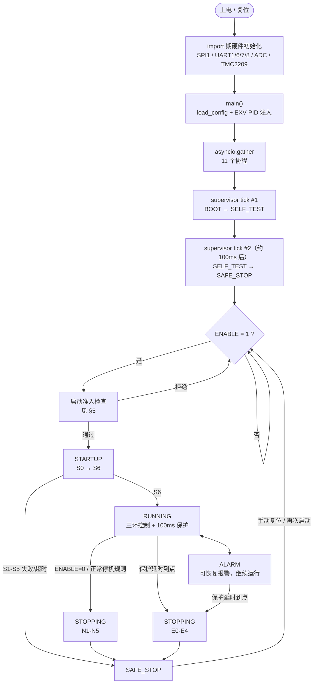

---

## 1. 阶段 A：上电与 import 期（t ≈ 0）

`main.py` 的 import 会**先于** `main()` 执行所有模块级代码。这一阶段已经占用了大部分硬件资源，也是现场「上电就卡住/启动失败」的第一排查点。

| 顺序 | 模块 | import 期实际动作 | 说明 |
|---|---|---|---|
| 1 | `Board/board.py` | `SPIBus(1, 500k)` + CS `PG15`；`UART(1,115200)`；`UART(8,9600)`；`SmoothedADC(PC2/PC3, window=16)`；`ADC(PA4)`、`ADC(PA5)`；流量 DI 软件占位 | 只建「哑资源」，不建 AD7124 芯片实例 |
| 2 | `EXV/EXV.py` | 模块级 `_motor = TMC2209(...)`：UART7 115200、PD13/PE10/PE12、等待 100ms、写驱动寄存器 | ⚠ 上电即初始化 TMC2209（B5 已知项），失败会影响整个 import |
| 3 | `Board/state.py` | 建立全部全局数据面；`sys_mode = MODE_BOOT`；`error_reg = 0xFFFFFFFF`；`sensor_quality` 全 `Q_BAD` | 参数单源；控制通道初始不可用 |
| 4 | `Compressor/control.py`<br/>`Condenser/control.py`<br/>`Evaporator/control.py` | 模块级创建容量环/转速环/压力环 PID 实例 | 用 `state` 默认参数建实例，后续由 Modbus 写入同步 |
| 5 | `HAL/Driver.py` | **不建 UART6**；只定义 `get_driver_link()` | 首次调用时才初始化，失败可降级 |
| 6 | `Display_Touch/modbus_slave.py` | `regs` 四区寄存器全部为 0 | 等 `sync_loop()` 200ms 后回填默认值 |
| 7 | `Board/params_store.py` | 不读文件 | 由 `main()` 显式 `load_config()` |

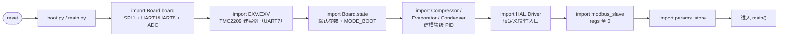

**这一阶段完成后的初始值**：

- `sys_mode = MODE_BOOT (0)`
- `state_data[ST_SYSTEM_ENABLE] = 0`
- `error_reg = 0xFFFFFFFF`（全正常）
- `sensor_data = [999] * 10`、`sensor_quality = [Q_BAD] * 10`
- `supervisor_interlocks` 全部 `False / 0`
- `driver_link_ok = True`（⚠ 初值为 True，真正状态由 `DriverLink()` 首次轮询覆盖）

---

## 2. 阶段 B：`main()` 启动编排

`main.py:133` 的 `main()` 只做三件事，业务逻辑都在各协程里：

1. **加载持久化参数**：`params_store.load_config()`（`main.py:136`）
   - 读 `config.json` → 校验 `version` / `checksum` → `apply_params()` 覆盖 `state` 参数字典。
   - 文件缺失、JSON 损坏、版本过高、checksum 不符：**保留 `state.py` 默认值**，不阻止启动。
2. **创建并注入 EXV 过热度 PID**：`IncrementalController(...)`（`main.py:139`），然后 `exv_ctrl.set_controller(ctrl_exv)`（`main.py:154`）。
3. **启动 11 个协程**：`asyncio.gather(...)`（`main.py:157`）。

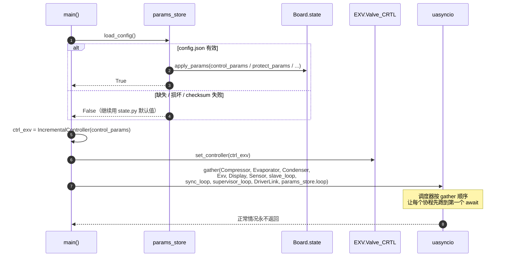

**gather 顺序（也是首轮调度顺序）**：

`Compressor → Evaporator → Condenser → Exv → Display → Sensor → modbus slave_loop → modbus sync_loop → supervisor_loop → DriverLink → params_store.loop`

---

## 3. 阶段 C：11 个协程的首轮执行

这是「上电后前 1 秒到底发生了什么」的关键。`asyncio.gather` 会先让每个协程运行到第一个 `await`，因此顺序是确定的。

| # | 协程 | 首轮实际动作 | 首次让出点 | 后续周期 |
|---|---|---|---|---|
| 1 | `Compressor()` | 调 `get_driver_link()` → **在这里首次创建 UART6**；容量环因 `sys_mode=BOOT` 直接返回；`enabled=False` → `link.disable(0)` | `sleep_ms(500)` | 0.5s |
| 2 | `Evaporator()` | `link.disable(1)` | `sleep_ms(500)` | 0.5s |
| 3 | `Condenser()` | `link.disable(2)` | `sleep_ms(500)` | 0.5s |
| 4 | `Exv()` | `exv_ctrl.run()`：`ENABLE=0` → `sleep_ms(100)` 后返回；外层再睡 1s | `sleep_ms(1000)` | 每约 1.1s 重试 |
| 5 | `Display()` | 通过 UART1 发一帧 A5 5A 测试屏数据 | `sleep(1)` | 1s |
| 6 | `Sensor()` | `adc_pc2c.sample()`、`adc_pc3c.sample()`；`reads_async()` 首次惰性建 AD7124；`validate()` | `sleep_ms(200)` | 200ms（墙上约 760-850ms） |
| 7 | `modbus_slave.slave_loop()` | 打印 `[Modbus] RTU从机启动`；进入 `_read_frame()` 等 UART8 | 等帧（`sleep_ms(2)` 轮询） | 事件驱动 |
| 8 | `modbus_slave.sync_loop()` | `sync_coils_from_state()`、`sync_input_regs()`、`sync_holding_readback()` | `sleep_ms(200)` | 200ms |
| 9 | `supervisor.supervisor_loop()` | `tick()` #1：`BOOT → SELF_TEST` | `sleep_ms(100)` | 100ms |
| 10 | `DriverLink()` | `get_driver_link()`（已由 Compressor 创建）；`link.disable(0..3)`；进入轮询 | `sleep_ms(5)` | 5ms；每 10ms 发命令 |
| 11 | `params_store.loop()` | `tick()`（无 dirty，直接返回） | `sleep_ms(1000)` | 1s |

**约 100ms 后**：`supervisor` tick #2 执行 `SELF_TEST → SAFE_STOP`（`supervisor.py:692-694`）。  
**约 200ms 后**：Modbus `sync_loop` 把 `holding_regs` 回填为当前默认参数；`coils[2..5]`、`coils[7]` 被置 1，但 **`coils[0]`（系统使能）仍为 0**。

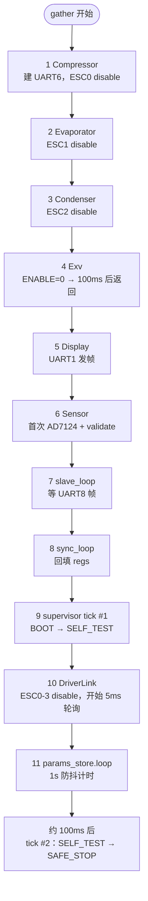

---

## 4. 阶段 D：`sys_mode` 状态机

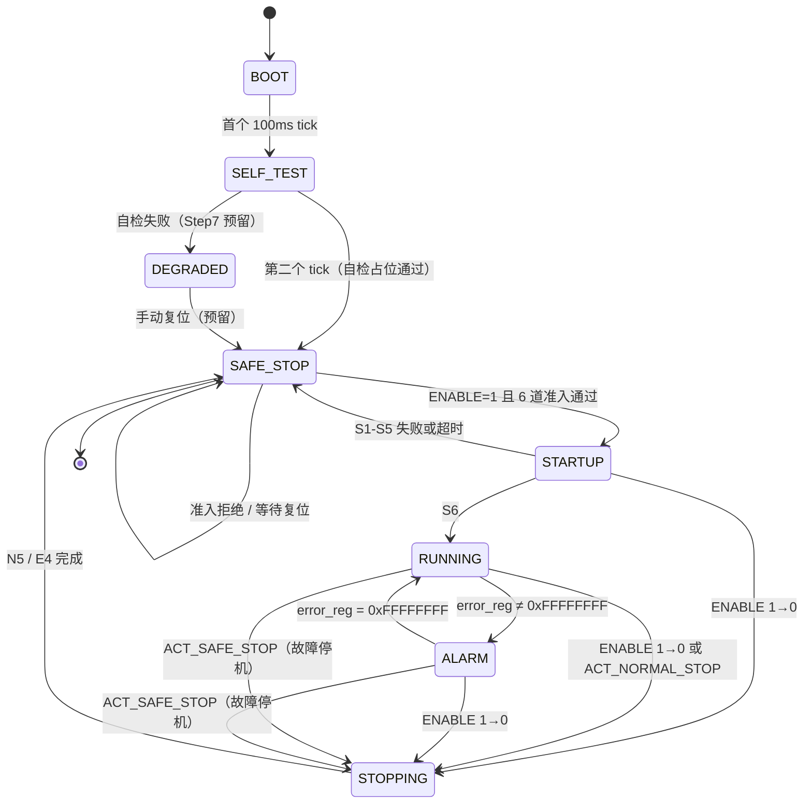

**状态含义与输出**：

| 状态 | 值 | 设备输出 | 进入条件 / 说明 |
|---|---|---|---|
| `MODE_BOOT` | 0 | 全禁用 | 上电初始 |
| `MODE_SELF_TEST` | 1 | 全禁用 | 外设自检占位；Step3 直接通过 |
| `MODE_SAFE_STOP` | 2 | 全禁用 | 默认待机；`_all_outputs_off()` |
| `MODE_STARTUP` | 3 | 按 S1-S6 逐步使能 | 6 道准入通过 |
| `MODE_RUNNING` | 4 | 三环控制 | S6 完成 |
| `MODE_ALARM` | 5 | **保持最后联锁值继续运行** | 有可恢复故障位；⚠ 见 §10 |
| `MODE_STOPPING` | 6 | 按 N/E 时序收尾 | 正常停机 / 故障停机 |
| `MODE_DEGRADED` | 7 | 待定 | 自检失败降级（预留） |

**`SAFE_STOP` 里的输出**（`_all_outputs_off()`）：

```text
comp_enable=False, comp_throttle_cmd=0
evap_fan_enable=False, evap_fan_throttle_cmd=0
cond_fan_enable=False, cond_fan_throttle_cmd=0
exv_enable=False, exv_target_pct=0.0
```

---

## 5. 阶段 E：启动准入（`SAFE_STOP → STARTUP`）

`supervisor.tick()` 在 `SAFE_STOP` 中每 100ms 检查一次，只有以下 6 道门全部通过才会进入 `STARTUP`：

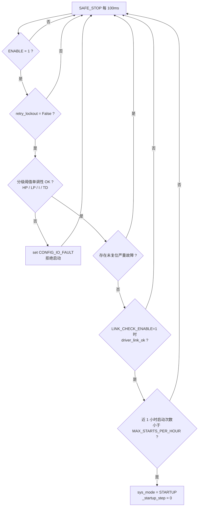

**严重故障集合**（任一存在即禁止启动，`supervisor.py:73`）：

`HIGH_PRESSURE_FAULT`、`DISCHARGE_PSI_FAULT`、`LOW_PRESSURE_FAULT`、`SUCTION_PSI_FAULT`、`OVERCURRENT_FAULT`、`SENSOR_STALE_FAULT`、`EXV_FAULT`、`COMPRESSOR_FAULT`、`EVAP_FAN_FAULT`、`COND_FAN_FAULT`、`FLOW_FAULT`；另外 `CURRENT_BAD_ACTION=1` 时的 `CURRENT_SENSOR_FAULT`、以及 `driver_link_latched` 也算。

**阈值单调性检查**（`_validate_threshold_monotonicity()`）：

- HP / I / TD：`warn < unload < trip`
- LP：`LP_MIN < LP_UNLOAD < LP_WARN`

---

## 6. 阶段 F：STARTUP S0-S6（核心图）

### 6.1 决策流程图

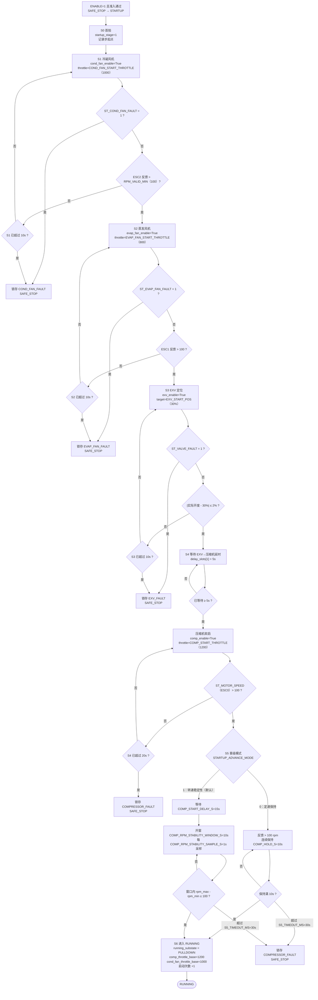

### 6.2 启动步与参数、失败映射

| 步 | 动作 | 成功判据 | 超时/失败 | 失败锁存位 |
|---|---|---|---|---|
| S0 | 锁存启动请求，`startup_stage=1` | 进入 STARTUP 后的第一拍 | — | — |
| S1 | 冷凝风机，油门 `COND_FAN_START_THROTTLE=1000` | `ST_ESC2_RPM > 100` | `S1_TIMEOUT_MS=10000` | `COND_FAN_FAULT` |
| S2 | 蒸发风机，油门 `EVAP_FAN_START_THROTTLE=800` | `ST_ESC1_RPM > 100` | `S2_TIMEOUT_MS=10000` | `EVAP_FAN_FAULT` |
| S3 | EXV 到 `EXV_START_POS=30%` | 到位误差 ≤ 2% | `S3_TIMEOUT_MS=10000` | `EXV_FAULT` |
| S4 | 先等 `delay_slots[1]=5s`，再压缩机 1200 油门 | `ST_MOTOR_SPEED > 100` | `S4_TIMEOUT_MS=20000` | `COMPRESSOR_FAULT` |
| S5 | 模式 0：定速保持 10s；模式 1：15s 延时 + 10s 稳定性窗口 | 见上图 | `S5_TIMEOUT_MS=30000` | `COMPRESSOR_FAULT` |
| S6 | 进入 RUNNING，初始化外环油门基值 | `sys_mode=RUNNING` | — | — |

> **注意**：S1/S2 的判据在代码里是 `> RPM_VALID_MIN`（默认 100），不是 DESIGN 表里写的 `> 0`。因此 Pico 必须回传有效 ESC 遥测，否则启动会卡在 S1 或 S2 直到超时。

### 6.3 启动过程的跨模块时序

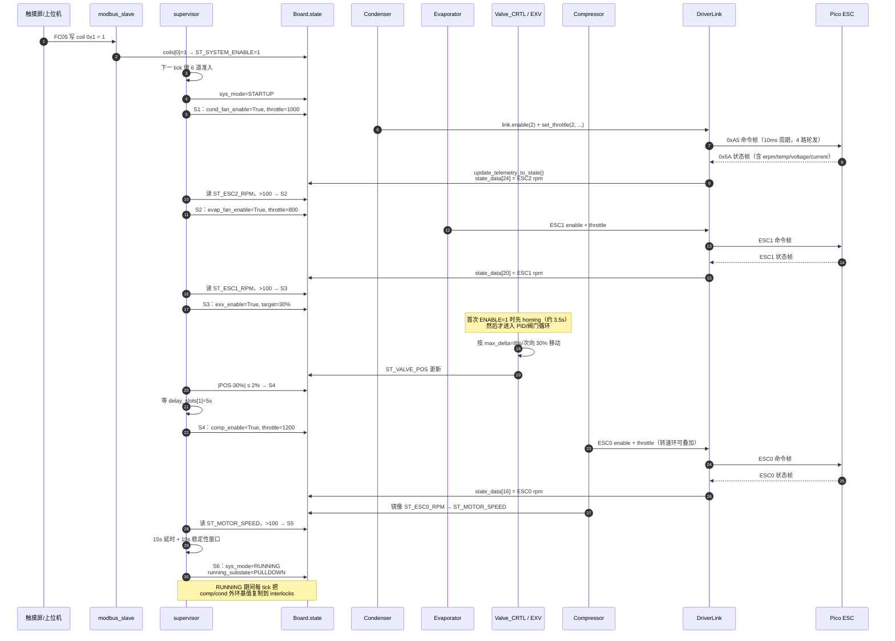

---

## 7. 阶段 G：RUNNING 运行过程

### 7.1 RUNNING 子状态（R1-R4）

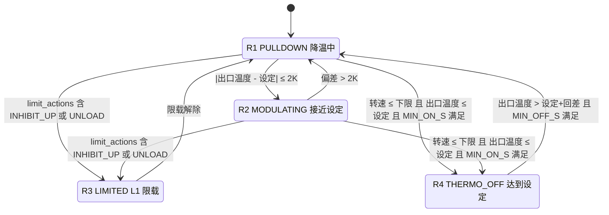

| 子状态 | 含义 | 执行机构行为 |
|---|---|---|
| R1 `PULLDOWN` | 降温中，容量环全力 | 压缩机/冷凝风机按外环基值运行 |
| R2 `MODULATING` | 接近设定，精细调节 | 同上 |
| R3 `LIMITED` | 任一 L1 限载动作活跃 | 容量环禁升速/降容；冷凝风机可能全速 |
| R4 `THERMO_OFF` | 达到设定，温控停机 | 压缩机停、EXV 关至 10%、冷凝风机停；蒸发风机默认保持（`EVAP_FAN_THERMO_OFF_KEEP=1`） |

温控参数：`MIN_ON_S=180`、`MIN_OFF_S=300`、`THERMO_HYST=2.0K`、`MODULATING_THRESHOLD=2.0K`、`MAX_STARTS_PER_HOUR=6`。

### 7.2 周期任务总表

| 协程 / 循环 | 周期 | 主要工作 |
|---|---|---|
| `supervisor.tick()` | 100ms | 汇总传感器故障、处理复位、遍历 22 条规则、状态机迁移、复制外环基值到联锁 |
| `Sensor()` | 200ms（墙上约 760-850ms） | 5×PT100 + 2×压力 + 电流 + 派生 SH/E/SC；`validate()` |
| `DriverLink()` | 5ms 轮询 / 10ms 发命令 | 收 Pico 状态帧、换算遥测、发 4 路命令；100ms 无帧判链路断 |
| `Compressor()` | 500ms | 容量环 10s、转速环 0.5s、ESC0 油门、故障事件位 |
| `Evaporator()` | 500ms | 蒸发风机转速环、ESC1 油门、故障事件位 |
| `Condenser()` | 500ms | 冷凝压力环 2s、转速环 0.5s、ESC2 油门、故障事件位 |
| `Exv()` → `pid_loop()` | 1s | 启动/停机/手动直接定位；RUNNING 过热度 PID |
| `Exv()` → `valve_loop()` | 100ms | 取出 `pending_delta`，执行阀门移动，回写开度 |
| `slave_loop()` | 事件驱动 | Modbus RTU 收帧/解析/应答 |
| `sync_loop()` | 200ms | coils / input_regs / holding_regs 三区镜像同步 |
| `Display()` | 1s | UART1 A5 5A 测试屏刷帧 |
| `params_store.loop()` | 1s | 30s 防抖落盘检查 |

**三个控制环**：

| 环 | 周期 | 被控量 | 输出 | 质量门禁 |
|---|---|---|---|---|
| 容量环 | 10s（`period_s` 可配） | 蒸发器出口空气温度 `IDX_OUTLET_T` | `comp_throttle_base` | `Q_OK` 且 age ≤ 2000ms |
| 冷凝压力环 | 2s（`period_s` 可配） | 排气压力 `IDX_DISCHARGE_PSI` | `cond_fan_throttle_base` | `Q_OK` 且 age ≤ 2000ms |
| 过热度环 | 1s | 过热度 `IDX_SUPERHEAT` | EXV 增量 | `Q_OK` 且 age ≤ 3400ms |
| 转速环（内环） | 0.5s | ESC0/1/2 反馈 rpm | 油门增量 | 由 `*_SPEED_LOOP_ENABLE` 开关控制 |

### 7.3 运行期数据流与单一写者

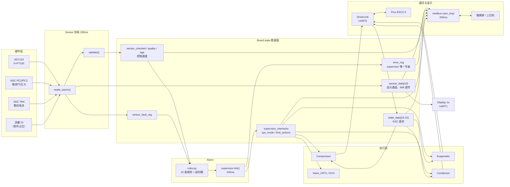

**写者约束**（改代码前务必遵守）：

| 数据 | 唯一写者 |
|---|---|
| `sensor_data` | `Sensor()` |
| `sensor_checked` / `quality` / `checked_ms` | `validate()` |
| `sensor_fault_reg` | `update_all_sensor_faults()` |
| `error_reg` | **仅 `Alarm/supervisor.py`** |
| `supervisor_interlocks` | **仅 `supervisor`** |
| `driver_link_ok` | `main.DriverLink()` |
| `state_data[0]` 压缩机转速 | `Compressor`（从 ESC0 镜像） |
| `state_data[1-3]` EXV | `Valve_CRTL` / `EXV` |
| `state_data[5]/[8]` 风机转速 | `Evaporator` / `Condenser` |
| `state_data[16-31]` ESC 遥测 | `HAL/Driver.update_telemetry_to_state()` |

### 7.4 RUNNING 的联锁刷新规则

每 100ms，`supervisor` 在 `MODE_RUNNING` 且 `running_substate != THERMO_OFF` 时执行：

```text
il.comp_enable          = True
il.cond_fan_enable      = True
il.evap_fan_enable      = True
il.comp_throttle_cmd     = state.comp_throttle_base      # 容量环输出
il.cond_fan_throttle_cmd = state.cond_fan_throttle_base  # 冷凝压力环输出
```

设备层再各自处理：

- **压缩机**：手动模式 0x2=1 时用 `4x220` 覆盖；否则用联锁油门；转速环可叠加修正。
- **冷凝风机**：手动模式用 `4x221` 覆盖；`ACT_COND_FAN_MAX` 时强制 2047。
- **蒸发风机**：RUNNING 期间**始终**读 `EVAP_FAN_USER_THROTTLE`（4x222），不跟随联锁油门。
- **EXV**：RUNNING 自动走过热度 PID；手动模式用 `4x223`；启动/停机由 `exv_target_pct` 直接定位。

### 7.5 进入 ALARM 与恢复

- RUNNING 中只要 `error_reg != 0xFFFFFFFF`，下一 tick 进入 `MODE_ALARM`（可恢复报警，继续运行）。
- 所有位恢复为 1 后，自动回 `RUNNING`，子状态重置为 `PULLDOWN`，外环基值若为 0 则回填启动油门。
- 锁存型故障（`latch=True`）不会自动清除，必须走手动复位。

---

## 8. 阶段 H：停机、故障与复位

### 8.1 正常停机（N0-N5）

触发：`ENABLE` 从 1 变 0，或 `MODBUS_COMM_FAULT`（60s 无有效帧）产生 `ACT_NORMAL_STOP`。

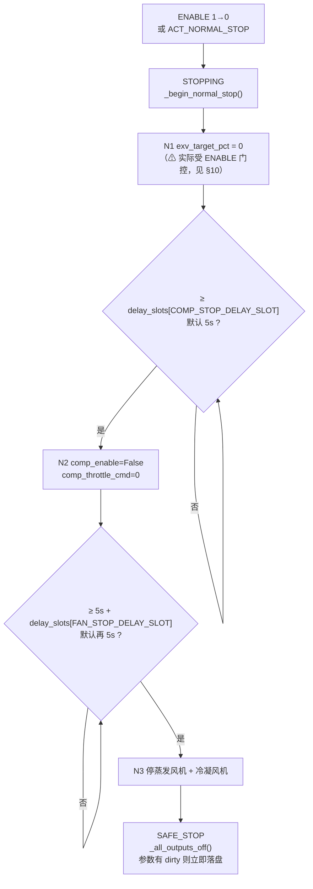

### 8.2 故障停机（E0-E4）

触发：某条规则条件连续成立到自己的延时（`delay_slots[X]` 或 `*_DELAY_S`）之后，动作含 `ACT_SAFE_STOP`。

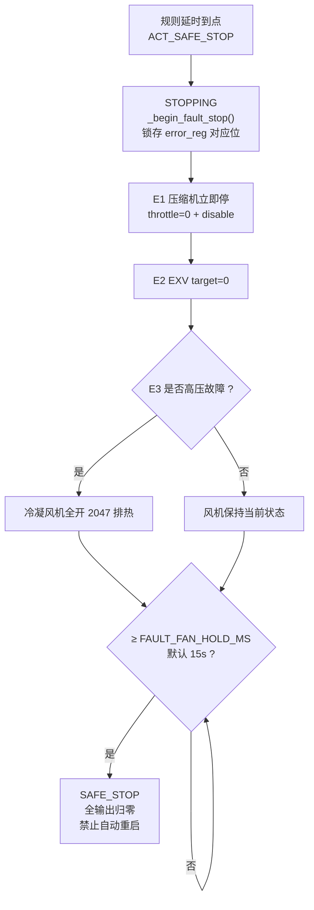

**故障停机与正常停机的区别**：

- 故障停机**立即**停压缩机（不等 5s）；
- 高压故障时冷凝风机**全速排热**；
- 风机保持 `FAULT_FAN_HOLD_MS=15s` 后才全停；
- 故障位锁存，`SAFE_STOP` 后不会自动重启。

### 8.3 手动复位

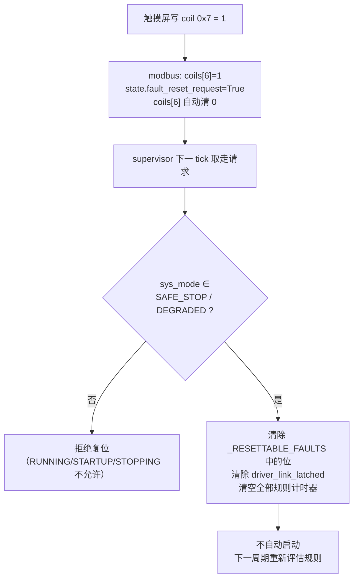

复位只清「可复位」位；条件仍存在时，规则会重新计时并再次锁存。复位**不会**自动把系统拉回 RUNNING，仍需 `ENABLE` 和启动准入。

---

## 9. 时间基准速查

| 量 | 默认值 | 来源 |
|---|---|---|
| supervisor 扫描 | 100ms | `supervisor.TICK_MS` |
| Sensor 周期 | 200ms（墙上约 760-850ms） | `main.Sensor()` |
| DriverLink 轮询 | 5ms | `main.DriverLink()` |
| ESC 命令周期 | 10ms | `CMD_PERIOD_MS` |
| Driver 链路超时 | 100ms | `UartLink.LINK_TIMEOUT_MS` |
| Modbus 镜像 | 200ms | `sync_loop(period_ms=200)` |
| 参数落盘防抖 | 30s | `SAVE_DEBOUNCE_MS` |
| Modbus 通讯断停机 | 60s | `MODBUS_TIMEOUT_S` |
| EXV homing | 约 3.5s（750ms + 2000ms + 750ms） | `TMC2209.homing()` |
| S1/S2 超时 | 10s | `S1_TIMEOUT_MS` / `S2_TIMEOUT_MS` |
| S3 超时 | 10s | `S3_TIMEOUT_MS` |
| S4 超时 | 20s（含 5s EXV→压缩机延时） | `S4_TIMEOUT_MS` |
| S5 超时 | 30s | `S5_TIMEOUT_MS` |
| S5 模式 1 | 15s 延时 + 10s 窗口 | `COMP_START_DELAY_S` / `COMP_RPM_STABILITY_WINDOW_S` |
| 正常停机压缩机延时 | 5s | `delay_slots[1]` |
| 正常停机风机延时 | 再 5s | `delay_slots[1]` |
| 故障停机风机保持 | 15s | `FAULT_FAN_HOLD_MS` |
| 温控最短运行 | 180s | `MIN_ON_S` |
| 温控最短停机 | 300s | `MIN_OFF_S` |

---

## 10. 代码现状与 DESIGN 的差异 / 风险点

以下不是「设计要求」，而是按当前代码实际执行会看到的行为，调试时请优先核对：

1. **⚠ 正常停机的 EXV 关闭（N1）实际不执行**
   - `_begin_normal_stop()` 设置 `exv_target_pct=0`，但正常停机的前提是 `ST_SYSTEM_ENABLE=0`。
   - `Valve_CRTL.pid_loop()`（`Valve_CRTL.py:139`）和 `valve_loop()`（`Valve_CRTL.py:185`）在 `ST_SYSTEM_ENABLE=0` 时直接清空 `pending_delta` 并睡眠，不会消费该目标。
   - 结果是 EXV 保持在停机前开度，直到 `SAFE_STOP` 的 `_all_outputs_off()` 把 `exv_enable` 置 False（但阀门位置仍不会自动归零）。
   - 若需要真正的「先关阀再停机」，应把 EXV 停机路径从 `ST_SYSTEM_ENABLE` 门控中解耦，或由 `MODE_STOPPING` 单独驱动。

2. **⚠ S3 超时余量可能不足**
   - 首次 `ENABLE=1` 后 `Exv.run()` 先做 homing（约 3.5s），然后才进入 PID/阀门循环。
   - 直接定位时每次最多移动 `control_params["max_delta"]=8%`；每次移动耗时约 `750ms + 40步/40Hz + 750ms ≈ 2.5s`。
   - 从 0% 到 30% 约需 4 次移动 ≈ 10s，加上 homing 3.5s，总计约 13.5s；而 `S3_TIMEOUT_MS=10000`。
   - 现场若从全关启动且 S3 反复超时，可调整 `max_delta`、`EXV_START_POS`、`S3_TIMEOUT_MS`，或在使能前提前 homing。

3. **⚠ ALARM 期间联锁不刷新**
   - `MODE_ALARM` 分支只处理 ENABLE 和故障恢复，不重新把 `comp_throttle_base` / `cond_fan_throttle_base` 复制到 `supervisor_interlocks`。
   - 设备层会继续按**最后一次**联锁值运行，直到故障恢复或停机。若 ALARM 持续很久，外环新的计算结果不会下发。

4. **⚠ `DriverLink()` 初始化失败会永久退出**
   - `DriverLink()` 在 `get_driver_link()` 返回 `None` 时直接 `return`，之后没有协程再轮询 Pico。
   - 设备模块仍会周期性调用 `get_driver_link()` 重试，但 `state.driver_link_ok` 初值为 `True` 且无人更新，遥测会停留在旧值/999。现场应把「链路初始化失败」纳入显式故障处理。

5. **⚠ `main.Exv()` 的外层 1s 循环在使能后不再生效**
   - `exv_ctrl.run()` 在 `ENABLE=1` 后会 `await asyncio.gather(pid_loop(), valve_loop())`，两个子循环永不返回，因此外层 `while True` 实际只用于「使能前每 1s 重试」。
   - 这是当前设计用法，不是 bug，但阅读时不要误以为每秒会重新 homing。

6. **注释与常量不一致**
   - `main.DriverLink()` 注释写「每 20ms 发送一次（50Hz）」，实际 `CMD_PERIOD_MS = 10`（100Hz）。
   - DESIGN 的 S1/S2 判据写 `> 0`，代码是 `> RPM_VALID_MIN`（默认 100）。

---

## 11. 代码入口索引

| 想看什么 | 文件 / 函数 |
|---|---|
| 协程编排、PID 注入 | `main.py:133` `main()`；`main.py:157` `asyncio.gather` |
| 状态机、启动/停机时序、规则遍历 | `Alarm/supervisor.py:655` `tick()`；`:302` `_startup_tick()`；`:474` `_stopping_tick()` |
| 规则条件与动作表 | `Alarm/rules.py:432` `RULES` |
| 全局数据面、参数默认值 | `Board/state.py` |
| 参数持久化 | `Board/params_store.py:83` `load_config()`；`:177` `loop()` |
| 传感器采集与校验 | `Sensor/read_sensors.py:114` `reads_async()`；`Sensor/validate.py:77` `validate()` |
| ESC 链路协议 | `HAL/Driver.py:152` `UartLink`；`:248` `update_telemetry_to_state()` |
| Modbus 从机与镜像 | `Display_Touch/modbus_slave.py:554` `slave_loop()`；`:782` `sync_loop()` |
| EXV PID 与阀门调度 | `EXV/Valve_CRTL.py:136` `pid_loop()`；`:182` `valve_loop()`；`:231` `run()` |
| EXV 归零与移动 | `EXV/EXV.py:149` `homing()`；`:221` `move_delta_pct()` |
| 压缩机/风机执行层 | `Compressor/control.py:136`；`Evaporator/control.py:48`；`Condenser/control.py:125` |
| 测试屏 | `Display_Touch/Display.py:55` `display()` |

---

## 12. 建议的现场启动观察顺序

1. **上电 1s 内**：看串口是否打印 `[Driver] UART6 link 已初始化`、`[Modbus] RTU从机启动 addr=1 baud=9600 UART8`。
2. **待机**：确认 `sys_mode=2`（SAFE_STOP）、`error_reg=0xFFFFFFFF`、`coils[0]=0`。
3. **写 coil 0x1=1**：应在 100-200ms 内看到 `SAFE_STOP -> STARTUP`。
4. **S1/S2**：确认 ESC2/ESC1 遥测 rpm 从 999 变为有效值；若一直 999，先查 Pico 链路与 `update_telemetry_to_state()`。
5. **S3**：看 `[EXV] homing OK` 与 `[Valve] 完成`；若 10s 内不到位，参考 §10.2。
6. **S4**：看 `[Supervisor] S4 完成`；确认 `ST_MOTOR_SPEED` 来自 ESC0 镜像而非 999。
7. **S5**：默认模式 1，约 25s 后应打印 `S5 完成: 转速稳定`。
8. **S6/RUNNING**：确认 `[Supervisor] S6: 进入 RUNNING`、`running_substate=0`，随后观察三个环的 `[Compressor] 容量环`、`[Condenser] 压力环`、`[PID] SH=` 日志。
9. **停机**：写 coil 0x1=0，确认 5s 后压缩机停、再 5s 后风机停，最终 `-> SAFE_STOP`。
