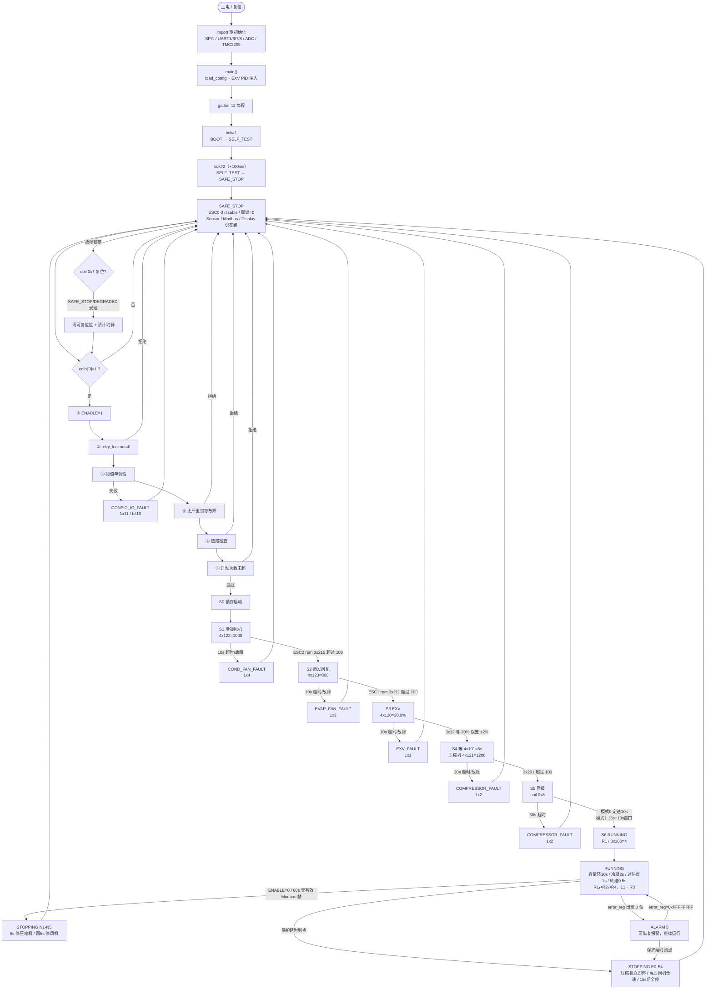
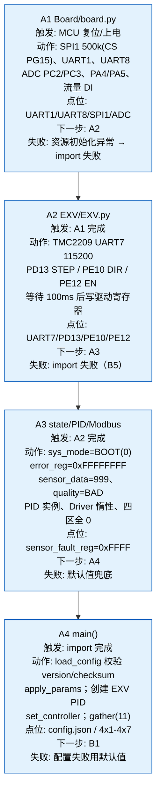
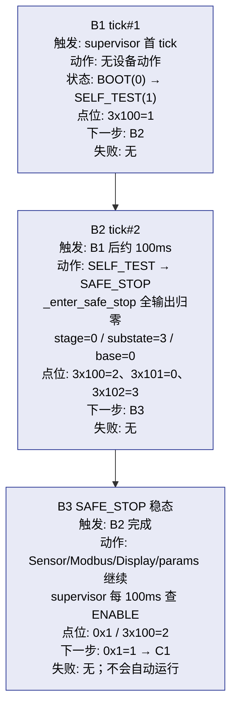
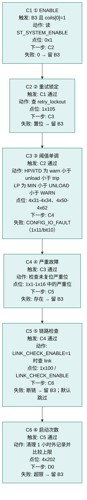
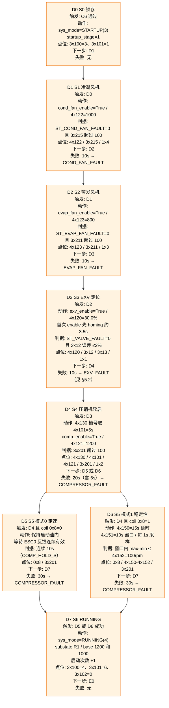
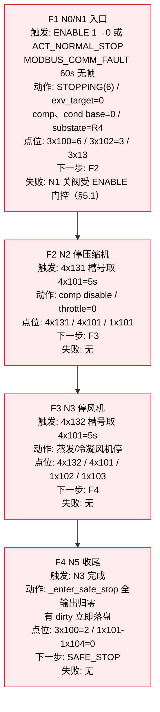
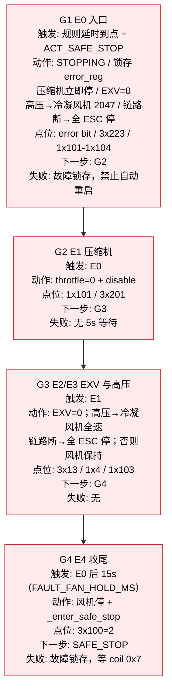
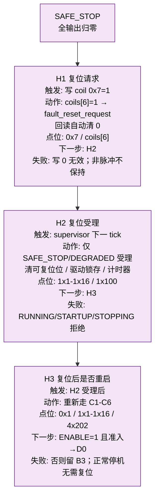
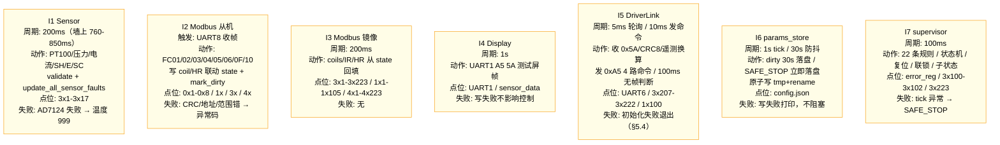

# 全系统启动 · 运行 · 点位合并图

**定位**：把上电、初始化、协程调度、状态机、启动 S0-S6、RUNNING 三环、停机/故障/复位，以及 Modbus 四区点位、`sensor_data` / `state_data` / `error_reg` 全部整合到一张**超级大 Mermaid 图**里；同时保留 A-I **分组 Mermaid** 便于逐组放大查看，顶部保留一页总览。
**硬件信号映射**：物理 I/O、MCU 引脚/总线到软件索引和执行器反馈的专表见 [`IO_MAP.md`](IO_MAP.md)；本文的重点是运行流和 HMI 点位。
**代码基准**：2026-10-29 当前工作区（含未提交改动）。入口 `main.py`，状态机 `Alarm/supervisor.py`。
**读图约定**：
- `ENABLE` = `state.state_data[ST_SYSTEM_ENABLE]`（coil 0x1）。
- `3xN` = 输入寄存器显示地址；`4xN` = 保持寄存器显示地址；`1xN` = 离散输入；`0xN` = 线圈。
- `di[i]`、`ir[i]`、`hr[i]`、`coils[i]` 中的 `i` 是**报文地址 = 显示地址 − 1**。
- 标「⚠」的是代码现状与 `DESIGN.md` 不完全一致之处，集中列在 §5。
- 图很大，建议在支持 Mermaid 的阅读器中**全屏 + 缩放**查看；节点按 ①-⑧ 分区。

---

## 0. 一页总览（保留，详细版）

> 这一节只回答 5 个问题：**谁先跑、什么时候允许启动、S1-S6 各判什么、RUNNING 在调什么、停机和复位到底做了什么**。  
> 更细的分组实现见 §1；系统级合并见 §2 超级大图；点位倍率见 §3。

### 0.1 主链路（带判据的 ASCII 图）

```text
A. 上电 / 复位（t≈0，import main.py）
   ① Board/board.py：SPI1 500k(CS PG15)、UART1 115200、UART8 9600、
      ADC PC2/PC3(16bit 压力)、PA4/PA5(12bit 电流)
   ② EXV/EXV.py：TMC2209 建实例（UART7 115200，PD13/PE10/PE12）
      import 期等待 100ms 后写驱动寄存器
   ③ Board/state.py：sys_mode=BOOT(0)、error_reg=0xFFFFFFFF、sensor_data=999
   ④ 其余：PID 实例、Driver 惰性入口、Modbus regs 全 0
        │
        ▼
B. main()（import 完成后）
   params_store.load_config() → 校验 version/checksum → apply_params()
     · 文件缺失/损坏/版本过高/checksum 不符 → 保留 state.py 默认值，不阻止启动
   创建 EXV 过热度 PID → exv_ctrl.set_controller()
   asyncio.gather(11 协程)
     首轮顺序：Compressor 建 UART6 → ESC0/1/2 disable
               Exv 因 ENABLE=0 不 homing；Sensor 首采并建 AD7124
               slave_loop 等 UART8；supervisor tick#1；DriverLink disable ESC0-3
        │
        ▼
C. 自动进入待机（无需人工；时机受 Sensor 首轮初始化影响，通常数百 ms 内）
   tick#1：BOOT(0) → SELF_TEST(1)
   tick#2：tick#1 之后约 100ms → SELF_TEST(1) → SAFE_STOP(2)
   SAFE_STOP 实际输出：comp/evap/cond/exv enable=False，全部 throttle=0
   仍在运行：Sensor 200ms、Modbus 从机、Display 1s、参数落盘 1s、保护 tick 100ms
   尚未执行：EXV homing（要等第一次 ENABLE=1 后由 Exv.run() 执行）
        │
        ▼ 等待 coil 0x1（显示地址 1 / coils[0]）= 1
D. 启动准入（每 100ms 重查；任一拒绝都留在 SAFE_STOP，不进入 STARTUP）
   ① ENABLE=1（coil 0x1）
   ② retry_lockout=0（1x105）
   ③ 阈值单调性：HP/I/TD 为 warn < unload < trip；LP 为 MIN < UNLOAD < WARN
      失败 → set CONFIG_IO_FAULT（1x11 / error bit10），本 tick 拒绝
   ④ 无未复位严重故障（1x1-1x16 中的严重位；范围见 §1.3 C4）
   ⑤ LINK_CHECK_ENABLE=1 时 driver_link_ok=1（1x100）；默认 0 时跳过
   ⑥ 近 1 小时启动次数 < 4x202 MAX_STARTS_PER_HOUR（默认 6）
        │
        ▼ 全部通过
E. STARTUP S0-S6（sys_mode=3；startup_stage 镜像 3x101）
   S0 锁存启动请求
   S1 冷凝风机 4x122=1000  ─ 成功: ESC2 rpm 3x215 > 100 ─ 10s 超时 → 1x4 COND_FAN_FAULT
   S2 蒸发风机 4x123=800   ─ 成功: ESC1 rpm 3x211 > 100 ─ 10s 超时 → 1x3 EVAP_FAN_FAULT
   S3 EXV 4x120=30%        ─ 成功: 3x12 与 30% 误差 ≤2% ─ 10s 超时 → 1x1 EXV_FAULT
   S4 等 4x101=5s → 压缩机 4x121=1200 ─ 成功: 3x201 > 100 ─ 20s 超时 → 1x2 COMPRESSOR_FAULT
   S5 晋级 coil 0x8：
      模式0 定速保持 10s
      模式1 延时 15s + 10s 窗口（4x152=100rpm）
      超时 30s → 1x2 COMPRESSOR_FAULT
   S6 sys_mode=RUNNING(4)，子状态 R1，外环基值 1200/1000，启动次数+1
        │
        ▼ S6
F. RUNNING（sys_mode=4）
   每 100ms supervisor：22 条保护规则 + 复制外环基值到 interlocks + 子状态迁移
   容量环 10s    3x4 出口空气温度 → 4x19 设定 → comp_throttle_base
   冷凝压力环 2s 3x6 排气压力     → 4x34 目标 → cond_fan_throttle_base
   过热度环 1s   3x8 过热度       → 4x4 设定  → EXV 增量
   转速环 0.5s   ESC0/1/2 rpm 反馈修正油门（coil 0x3/0x4/0x5）
   子状态迁移：
     R1→R2：3x4 与 4x19 偏差 ≤2K；R2→R1：偏差超过 2K
     R1/R2→R3：limit_actions 含 0x01/0x02；R3→R1：限载解除
     R1/R2→R4：rpm≤下限 且 3x4≤4x19 且 MIN_ON(4x200)满足
     R4→R1：3x4 超过 4x19+回差 且 MIN_OFF(4x201)满足
   可恢复故障 → ALARM(5)：继续运行；但 supervisor 不再刷新外环基值（见 §5.3）
   手动模式 coil 0x2=1：4x220/4x221/4x222/4x223 覆盖自动输出
        │
        ├─ ENABLE 1→0 或 Modbus 60s 无有效帧 → G. 正常停机 STOPPING（N1-N5）
        │     N1 EXV target=0（⚠ 代码受 ENABLE 门控，实际不会关阀）
        │     N2 等 4x101=5s → 压缩机停
        │     N3 再等 5s → 蒸发/冷凝风机停
        │     N5 → SAFE_STOP，全输出归零
        │
        └─ 保护延时到点 → H. 故障停机 STOPPING（E0-E4）
              E0 锁存 error_reg 对应位
              E1 压缩机立即停（不等 5s）
              E2 EXV target=0
              E3 高压故障 → 冷凝风机全速 2047
              E4 风机保持 15s → SAFE_STOP
                    │
                    ▼
I. SAFE_STOP 与复位
   正常停机后：无需复位，写 coil 0x1=1 且准入通过即可再次进入 STARTUP
   故障停机后：故障位锁存，先写 coil 0x7 脉冲（显示地址 7 / coils[6]）
   复位受理条件：sys_mode ∈ {SAFE_STOP, DEGRADED}
   复位动作：清可复位 error 位 + 清 driver_link_latched + 清全部规则计时器
   复位≠重启：之后是否进入 STARTUP 仍取决于 ENABLE 与 6 道准入：
     · ENABLE 仍为 1 且准入通过 → 下一 100ms tick 自动进入 STARTUP
     · ENABLE=0 或准入不通过 → 继续留在 SAFE_STOP，等待 coil 0x1=1

```

### 0.2 阶段对照表

| 阶段 | 触发 / 时机 | 代码实际动作 | 关键点位 | 退出 / 失败 |
|---|---|---|---|---|
| A 上电 / import | 复位释放 | 建 SPI1、UART1/8、ADC；TMC2209 建实例并等 100ms；state 置 BOOT / error_reg=0xFFFFFFFF / sensor=999；PID 实例；Modbus regs 全 0 | — | 进入 `main()` |
| B `main()` | import 完成 | `load_config()`（失败用默认值）→ 创建 EXV PID → `set_controller()` → `gather(11)` | `config.json` | `gather` 正常永不返回 |
| C 自动待机 | tick#1 / tick#2 | tick#1 `BOOT→SELF_TEST`；tick#2（+100ms）`SELF_TEST→SAFE_STOP`；`_all_outputs_off()` | `sys_mode` 3x100 | 停在 SAFE_STOP |
| D 启动准入 | `coil 0x1=1` 后每 100ms | 6 道门依次检查；拒绝则留在 SAFE_STOP；阈值失败置 `CONFIG_IO_FAULT` | 0x1、1x105、4x202、1x1-1x16、1x100 | 通过→STARTUP；拒绝→SAFE_STOP |
| E STARTUP | 准入通过 | S0-S6：冷凝风机→蒸发风机→EXV→压缩机→S5 晋级；失败锁存对应位 | 3x101、4x120-4x123、4x101、3x211/3x215/3x201 | S6→RUNNING；失败→SAFE_STOP |
| F RUNNING | S6 | 100ms 保护 + 容量环 10s + 冷凝压力环 2s + 过热度环 1s + 转速环 0.5s；R1-R4 | 3x4、3x6、3x8、3x100-3x102、3x200-3x223 | ENABLE=0/正常停机规则→STOPPING；故障→STOPPING |
| G 正常停机 | ENABLE 1→0 或 `MODBUS_COMM_FAULT`（60s 无帧） | N1 EXV target=0（⚠ 实际受门控）；N2 5s 停压缩机；N3 再 5s 停风机；N5 SAFE_STOP | 4x101、4x131、4x132 | SAFE_STOP |
| H 故障停机 | 规则延时到点且动作含 `ACT_SAFE_STOP` | E0 锁存；E1 压缩机立即停；E2 EXV=0；E3 高压→冷凝风机全速；E4 风机保持 15s | `error_reg`、3x223 | SAFE_STOP（故障锁存） |
| I 复位 / 再启动 | `coil 0x7` 脉冲 | 仅 SAFE_STOP/DEGRADED 受理；清可复位位+计时器；是否启动看 ENABLE 和 6 道门 | 0x7、0x1、1x1-1x16 | ENABLE=1 且准入通过→STARTUP；否则留 SAFE_STOP |

### 0.3 STARTUP 六步判据

| 步 | 输出 / 动作 | 成功判据 | 超时 | 失败锁存 |
|---|---|---|---|---|
| S0 | 锁存启动请求，`startup_stage=1` | 进入 STARTUP 后第一拍 | — | — |
| S1 | 冷凝风机，`4x122=1000` | `ST_COND_FAN_FAULT=0` 且 `3x215>100` | 10s | `COND_FAN_FAULT`（1x4） |
| S2 | 蒸发风机，`4x123=800` | `ST_EVAP_FAN_FAULT=0` 且 `3x211>100` | 10s | `EVAP_FAN_FAULT`（1x3） |
| S3 | EXV 到 `4x120=30.0%` | `ST_VALVE_FAULT=0` 且 `3x12` 与 30% 误差 ≤2% | 10s | `EXV_FAULT`（1x1） |
| S4 | 先等 `4x101=5s`，再压缩机 `4x121=1200` | `3x201>100` | 20s（含 5s 延时） | `COMPRESSOR_FAULT`（1x2） |
| S5 | 模式 0：定速保持；模式 1：15s 延时 + 10s 窗口 | 模式 0 连续 10s；模式 1 窗口内波动 ≤ `4x152=100rpm` | 30s | `COMPRESSOR_FAULT`（1x2） |
| S6 | `sys_mode=RUNNING`，子状态 R1 | 进入 RUNNING | — | — |

> **S5 余量**：模式 1 正常需要 15s + 10s = 25s，离 30s 超时只剩约 5s；若窗口因转速不稳反复重开，可能触发 S5 超时。  
> **S3 与 homing**：第一次 `ENABLE=1` 后 `Exv.run()` 先 homing（约 3.5s），再执行 30% 定位；S3 的 10s 超时是从进入 S3 开始算的，详见 §5.2。

### 0.4 六个容易误读的边界

1. **上电不会自动运行**：上电只走到 `SAFE_STOP`。必须写 `coil 0x1=1`，并通过 6 道准入，才会进入 `STARTUP`。只写 PID/保护参数而不写 0x1，系统会一直待机。  
   （本节的「上电 / 复位」指 MCU 复位或重新上电，不是 `coil 0x7` 故障复位。）
2. **`SAFE_STOP` 不是断电**：Sensor、Modbus 从机、Display、参数落盘、100ms 保护扫描都还在跑；只是 ESC0-3 禁用、联锁输出归零。EXV 也**不会在上电时 homing**，要等第一次 `ENABLE=1` 才执行。
3. **故障复位 ≠ 重新启动**：`coil 0x7` 只清可复位故障位和计时器。若 `ENABLE` 仍为 1 且 6 道准入通过，下一 100ms tick 会**自动**进入 STARTUP；若 `ENABLE=0`，则留在 SAFE_STOP 等 `coil 0x1=1`。正常停机后不需要复位。
4. **正常停机的 N1 关阀是「名义动作」**：`_begin_normal_stop()` 会写 `exv_target_pct=0`，但 `Valve_CRTL` 的 PID/阀门循环在 `ENABLE=0` 时被门控，实际不会执行关阀。详见 §5.1。
5. **`ALARM` 不是停机**：RUNNING 中只要出现可恢复故障位就进 `ALARM`，设备继续按最后一次联锁值运行；`ALARM` 期间 supervisor 不刷新外环基值，详见 §5.3。
6. **S1/S2 看的是 ESC 遥测，不是命令**：即使 supervisor 已经下发 1000/800 油门，如果 Pico 没有回传有效转速，`3x215`/`3x211` 仍是 999，S1/S2 会一直等到 10s 超时。启动前先确认 UART6 链路和 ESC 状态帧。

### 0.5 一页总览 Mermaid（可渲染版）




---

## 1. 全阶段总表（分组 Mermaid 版）

> 总表按 **A-I 九组拆开**，每组一张 Mermaid，便于单独放大查看；节点字段仍为 **触发 / 动作 / 点位 / 下一步 / 失败**。  
> 系统级合并图见 §2「全系统超级大图」，不再使用单张总表图。  
> 普通质量坏/超龄通常只冻结该环；`超时/失败` 里写的是会导致停机的路径。

### 1.1 A 上电与初始化



### 1.2 B 自动进入待机



### 1.3 C 启动准入（6 道门）



### 1.4 D STARTUP S0-S6



### 1.5 E RUNNING 三环与子状态

```mermaid
flowchart TB
    E0["E0 R1 PULLDOWN<br/>触发: D7<br/>动作: 外环投运<br/>supervisor 每 100ms 复制基值到 interlocks<br/>点位: 1x101-1x104 / 3x200-3x205<br/>下一步: E6/E7/E8<br/>失败: 无"]
    E1["E1 容量环<br/>触发: RUNNING 且非手动/非 R4<br/>周期: 4x24 默认 10s<br/>动作: PID 3x4 vs 4x19<br/>输出 comp_throttle_base / 限幅 4x21、4x22<br/>点位: 3x4 / 4x19 / 3x200 / 3x201<br/>失败: 质量坏或 age 超过 2000ms → 冻结"]
    E2["E2 冷凝压力环<br/>触发: RUNNING 且非手动/非 R4<br/>周期: 2s（内部参数）<br/>动作: PID 3x6 vs 4x34<br/>输出 cond_fan_throttle_base / 限幅 4x28、4x29<br/>L1 ACT_COND_FAN_MAX → 4x29<br/>点位: 3x6 / 4x34 / 3x204 / 3x205<br/>失败: 质量坏或 age 超过 2000ms → 冻结"]
    E3["E3 过热度环<br/>触发: RUNNING 且非手动<br/>周期: 1s<br/>动作: PID 3x8 vs 4x4<br/>输出 EXV 增量 / 限幅 4x7<br/>质量门禁 3400ms<br/>点位: 3x8 / 4x4 / 4x7 / 3x12 / 3x13<br/>失败: 质量坏/超龄 → 保持开度"]
    E4["E4 转速环<br/>触发: 每 0.5s<br/>使能: coil 0x3/0x4/0x5<br/>动作: 基础油门→目标 rpm→PID 修正<br/>反馈: 3x207/3x211/3x215<br/>点位: 3x201/3x203/3x205<br/>失败: 反馈 999 跳过 / 禁用开环"]
    E5["E5 蒸发风机<br/>触发: RUNNING 且使能<br/>动作: 始终用 4x222 用户油门<br/>映射 ESC1 / 镜像 3x202、3x203<br/>判据: 反馈有效且偏差 ≤ FAN_RPM_TOL<br/>点位: 4x222 / 3x202 / 3x203 / 1x3<br/>失败: ST_EVAP_FAN_FAULT 事件 → 规则延时"]
    E6["E6 R1 与 R2<br/>触发: RUNNING<br/>判据: 3x4 与 4x19 偏差 ≤2K → R2<br/>R2 偏差超过 2K → R1<br/>点位: 3x4 / 4x19<br/>下一步: E0<br/>失败: 无超时"]
    E7["E7 R3 LIMITED<br/>触发: 任一 L1 动作<br/>判据: limit_actions 含 0x01/0x02<br/>动作: 容量环禁升/降容<br/>点位: 3x223 / 4x185 / 4x186<br/>下一步: 限载解除 → R1<br/>失败: 条件持续保持 R3"]
    E8["E8 R4 THERMO_OFF<br/>触发: R1/R2 且 rpm≤下限<br/>且 3x4≤4x19 且 MIN_ON 满足<br/>动作: 压缩机停 / EXV 10% / 冷凝风机停<br/>蒸发风机保持 / comp、cond base=0<br/>点位: 4x200=180s / 4x201=300s<br/>下一步: 回差+MIN_OFF → R1<br/>失败: 无超时；R4 不更新外环"]
    E9["E9 ALARM<br/>触发: error_reg != 0xFFFFFFFF<br/>动作: 继续运行<br/>不刷新外环基值，保持最后联锁<br/>点位: 1x1-1x16 / 3x110 / 3x111<br/>下一步: 全部恢复 → RUNNING/R1<br/>失败: 锁存位需复位；持续报警可停机"]
    E10["E10 手动模式<br/>触发: coil 0x2=1 且 RUNNING<br/>动作: 4x220/4x221/4x222/4x223 覆盖<br/>L1 COND_FAN_MAX 仍覆盖冷凝风机<br/>点位: 0x2 / 4x220-4x223 / 3x223<br/>下一步: E0<br/>失败: 非 RUNNING 不生效"]
    E0 --> E1
    E0 --> E2
    E0 --> E3
    E0 --> E4
    E0 --> E5
    E0 --> E6
    E0 --> E7
    E0 --> E8
    E0 --> E9
    E0 --> E10
    E6 -.->|"R2→R1"| E0
    E7 -.->|"限载解除"| E0
    E8 -.->|"MIN_OFF"| E0
    E9 -.->|"恢复"| E0
    classDef run fill:#e8f5e9,stroke:#2e7d32,color:#000;
    class E0,E1,E2,E3,E4,E5,E6,E7,E8,E9,E10 run;
```



### 1.6 F 正常停机 N1-N5



### 1.7 G 故障停机 E0-E4



### 1.8 H 复位与再启动



### 1.9 I 常驻任务（与主链路并行）



## 2. 全系统超级大图（一个 Mermaid）

> 这张图按 ① 上电 → ② main/gather → ③ 状态机 → ④ 准入 → ⑤ STARTUP → ⑥ RUNNING → ⑦ 停机/故障/复位 → ⑧ 点位与数据面 组织。  
> ⑤ 里的 S1-S6、⑥ 里的 R1-R4 与三环、⑧ 里的四区点位都在同一张图内，虚线箭头表示「点位 → 消费者」。

```mermaid
flowchart TB
    subgraph L0["① 上电与 import 期"]
        direction TB
        PWR(["上电 / 复位"])
        IMP_BOARD["Board/board.py<br/>SPI1 500k CS=PG15<br/>UART1 115200 测试屏<br/>UART8 9600 Modbus<br/>ADC PC2/PC3 压力 16bit<br/>ADC PA4/PA5 电流 12bit<br/>流量 DI 软件占位"]
        IMP_EXV["EXV/EXV.py<br/>模块级 TMC2209<br/>UART7 115200<br/>PD13 STEP / PE10 DIR / PE12 EN<br/>上电等待 100ms 后写寄存器"]
        IMP_STATE["Board/state.py<br/>sys_mode=BOOT (0)<br/>error_reg=0xFFFFFFFF<br/>sensor_data=999 x10<br/>sensor_quality=BAD x10<br/>supervisor_interlocks 全 0"]
        IMP_PID["Compressor / Evaporator / Condenser<br/>模块级 PID 实例<br/>容量环 + 冷凝压力环 + 转速环"]
        IMP_DRV["HAL/Driver.py<br/>不建 UART6<br/>get_driver_link() 惰性初始化"]
        IMP_REG["Display_Touch/modbus_regs.py<br/>coils[8] 全 0<br/>di[116] 全 0<br/>hr[223] 全 0<br/>ir[223] 全 0"]
        PWR --> IMP_BOARD --> IMP_EXV --> IMP_STATE --> IMP_PID --> IMP_DRV --> IMP_REG
    end

    subgraph L1["② main() 编排与 gather"]
        direction TB
        MAIN_CFG["params_store.load_config()<br/>读 config.json<br/>校验 version / checksum<br/>apply_params() 覆盖 state 字典<br/>失败则保留 state.py 默认值"]
        MAIN_PID["IncrementalController(control_params)<br/>Kp=0.6 Ki=0.12 Kd=3.0<br/>setpoint=5.0 deadband=0.2<br/>max_delta=8.0 tau=3.0"]
        MAIN_INJ["exv_ctrl.set_controller(ctrl_exv)"]
        MAIN_GATHER["asyncio.gather 11 协程<br/>Compressor 500ms<br/>Evaporator 500ms<br/>Condenser 500ms<br/>Exv 1s + 100ms<br/>Display 1s<br/>Sensor 200ms<br/>slave_loop 事件驱动<br/>sync_loop 200ms<br/>supervisor 100ms<br/>DriverLink 5ms/10ms<br/>params_store 1s"]
        MAIN_FIRST["首轮调度顺序<br/>Compressor 建 UART6<br/>→ ESC0/1/2 disable<br/>→ Exv 等 ENABLE<br/>→ Sensor 建 AD7124<br/>→ slave_loop 等帧<br/>→ supervisor tick#1<br/>BOOT → SELF_TEST<br/>→ DriverLink disable 0-3"]
        MAIN_T2["约 100ms 后 tick#2<br/>SELF_TEST → SAFE_STOP<br/>_all_outputs_off()"]
        IMP_REG --> MAIN_CFG --> MAIN_PID --> MAIN_INJ --> MAIN_GATHER --> MAIN_FIRST --> MAIN_T2
    end

    subgraph L2["③ sys_mode 状态机"]
        direction LR
        M_BOOT["BOOT 0<br/>上电初始"]
        M_SELF["SELF_TEST 1<br/>自检占位"]
        M_SAFE["SAFE_STOP 2<br/>全输出禁用<br/>默认待机"]
        M_START["STARTUP 3<br/>S0-S6"]
        M_RUN["RUNNING 4<br/>三环控制"]
        M_ALARM["ALARM 5<br/>可恢复报警<br/>继续运行"]
        M_STOP["STOPPING 6<br/>N/E 时序"]
        M_DEG["DEGRADED 7<br/>自检失败（预留）"]
        MAIN_T2 --> M_BOOT
        M_BOOT -->|"tick#1"| M_SELF
        M_SELF -->|"tick#2"| M_SAFE
        M_SELF -->|"自检失败"| M_DEG
        M_SAFE -->|"ENABLE=1 + 准入"| M_START
        M_START -->|"S6"| M_RUN
        M_START -->|"S1-S5 失败/超时"| M_SAFE
        M_START -->|"ENABLE 1→0"| M_STOP
        M_RUN -->|"error_reg 出现 0 位"| M_ALARM
        M_ALARM -->|"error_reg=0xFFFFFFFF"| M_RUN
        M_RUN -->|"ENABLE=0 / ACT_NORMAL_STOP"| M_STOP
        M_ALARM -->|"ENABLE=0"| M_STOP
        M_RUN -->|"ACT_SAFE_STOP"| M_STOP
        M_ALARM -->|"ACT_SAFE_STOP"| M_STOP
        M_STOP -->|"N5 / E4"| M_SAFE
        M_DEG -->|"手动复位"| M_SAFE
    end

    subgraph L3["④ 启动准入（SAFE_STOP 每 100ms 检查）"]
        direction TB
        G_EN["① ENABLE=1<br/>coil 0x1"]
        G_RETRY["② retry_lockout=False<br/>1x105"]
        G_MONO["③ 阈值单调性<br/>HP/I/TD: warn 小于 unload 小于 trip<br/>LP: LP_MIN 小于 LP_UNLOAD 小于 LP_WARN"]
        G_SEV["④ 无未复位严重故障<br/>1x1-1x16 对应位"]
        G_LINK["⑤ LINK_CHECK_ENABLE=1 时<br/>driver_link_ok=1 (1x100)"]
        G_START["⑥ 近 1 小时启动次数<br/>小于 4x202 MAX_STARTS_PER_HOUR"]
        M_SAFE --> G_EN --> G_RETRY --> G_MONO --> G_SEV --> G_LINK --> G_START --> M_START
        G_MONO -->|"失败"| ERRCFG["set CONFIG_IO_FAULT<br/>1x11 di[10] / error bit 10"]
        G_SEV -->|"存在锁存"| M_SAFE
        G_START -->|"超限"| M_SAFE
    end

    subgraph L4["⑤ STARTUP S0-S6"]
        direction TB
        S0["S0 锁存启动请求<br/>startup_stage=1<br/>3x101=1"]
        S1["S1 冷凝风机<br/>cond_fan_enable=True<br/>4x122=1000 油门"]
        S1Q{"S1 通过？<br/>ST_COND_FAN_FAULT=0<br/>ESC2 rpm 3x215 超过 100<br/>10s 超时"}
        S2["S2 蒸发风机<br/>evap_fan_enable=True<br/>4x123=800 油门"]
        S2Q{"S2 通过？<br/>ST_EVAP_FAN_FAULT=0<br/>ESC1 rpm 3x211 超过 100<br/>10s 超时"}
        S3["S3 EXV 定位<br/>exv_enable=True<br/>4x120=30.0%<br/>目标镜像 3x13"]
        S3Q{"S3 到位？<br/>ST_VALVE_FAULT=0<br/>3x12 与 30% 误差 ≤2%<br/>10s 超时"}
        S4W["S4 等待 EXV→压缩机<br/>4x130 槽号 → 4x101=5s"]
        S4["S4 压缩机软启<br/>comp_enable=True<br/>4x121=1200 油门"]
        S4Q{"S4 通过？<br/>ST_MOTOR_SPEED 3x201 超过 100<br/>20s 超时"}
        S5{"S5 晋级模式<br/>coil 0x8"}
        S5A["模式0 定速保持<br/>ESC0 rpm 超过 100<br/>连续 10s"]
        S5B["模式1 转速稳定性<br/>4x150=15s 延时<br/>4x151=10s 窗口<br/>每 1s 采样<br/>4x152=100rpm 阈值"]
        S5T["S5 超时 30s"]
        S6["S6 进入 RUNNING<br/>sys_mode=4 / 3x100=4<br/>startup_stage=6 / 3x101=6<br/>running_substate=R1 / 3x102=0<br/>comp_throttle_base=1200<br/>cond_fan_throttle_base=1000<br/>启动次数 +1"]
        SF1["S1 失败<br/>set COND_FAN_FAULT<br/>1x4 di[3]"]
        SF2["S2 失败<br/>set EVAP_FAN_FAULT<br/>1x3 di[2]"]
        SF3["S3 失败<br/>set EXV_FAULT<br/>1x1 di[0]"]
        SF4["S4 失败<br/>set COMPRESSOR_FAULT<br/>1x2 di[1]"]
        SF5["S5 失败<br/>set COMPRESSOR_FAULT<br/>1x2 di[1]"]
        G_START --> S0 --> S1 --> S1Q
        S1Q -->|"通过"| S2
        S1Q -->|"故障/超时"| SF1
        S2 --> S2Q
        S2Q -->|"通过"| S3
        S2Q -->|"故障/超时"| SF2
        S3 --> S3Q
        S3Q -->|"到位"| S4W
        S3Q -->|"故障/超时"| SF3
        S4W -->|"≥5s"| S4
        S4 --> S4Q
        S4Q -->|"通过"| S5
        S4Q -->|"故障/超时"| SF4
        S5 -->|"模式0"| S5A
        S5 -->|"模式1"| S5B
        S5A -->|"保持满 10s"| S6
        S5B -->|"窗口波动 ≤100rpm"| S6
        S5A -->|"超时"| S5T
        S5B -->|"超时"| S5T
        S5T --> SF5
        SF1 --> M_SAFE
        SF2 --> M_SAFE
        SF3 --> M_SAFE
        SF4 --> M_SAFE
        SF5 --> M_SAFE
    end

    subgraph L5["⑥ RUNNING 三环与子状态"]
        direction TB
        R1["R1 PULLDOWN<br/>降温中，容量环全力"]
        R2["R2 MODULATING<br/>接近设定，精细调节"]
        R3["R3 LIMITED<br/>L1 限载中"]
        R4["R4 THERMO_OFF<br/>压缩机停 / EXV 10%<br/>冷凝风机停 / 蒸发风机保持"]
        C_CAP["容量环 10s<br/>被控 3x4 出口空气温度<br/>设定 4x19<br/>输出 comp_throttle_base<br/>镜像 3x200 油门 / 3x201 rpm"]
        C_COND["冷凝压力环 2s<br/>被控 3x6 排气压力<br/>设定 4x34 HP_TARGET<br/>输出 cond_fan_throttle_base<br/>镜像 3x204 油门 / 3x205 rpm"]
        C_SH["过热度环 1s<br/>被控 3x8 过热度<br/>设定 4x4<br/>输出 EXV 增量<br/>镜像 3x12 开度 / 3x13 目标"]
        C_EVAP["蒸发风机执行<br/>RUNNING 始终用 4x222<br/>映射 ESC1 油门<br/>镜像 3x202 / 3x203"]
        C_SPD["转速环 0.5s<br/>coil 0x3 压缩机<br/>coil 0x4 冷凝风机<br/>coil 0x5 蒸发风机<br/>ESC0/1/2 rpm 反馈修正油门"]
        C_SUP["supervisor 100ms<br/>复制外环基值到 interlocks<br/>comp/cond/evap enable<br/>1x101-1x104 镜像"]
        C_ALARM["保护规则 22 条<br/>延时槽 4x100-4x107<br/>error_reg 32bit<br/>1x1-1x16 + 3x110/3x111<br/>L1 动作码 3x223"]
        LIMIT["L1 限载动作码<br/>0x01 INHIBIT_UP 禁升速<br/>0x02 UNLOAD 降容<br/>0x04 COND_FAN_MAX 全速<br/>0x08 EXV_REDUCE 关小<br/>0x10 NORMAL_STOP<br/>0x20 SAFE_STOP"]
        MANUAL["手动模式 coil 0x2=1<br/>4x220 压缩机手动油门<br/>4x221 冷凝风机手动油门<br/>4x222 蒸发风机用户油门<br/>4x223 EXV 手动开度"]
        EXV_ACT["Valve_CRTL / EXV<br/>TMC2209 UART7<br/>PD13 STEP / PE10 DIR / PE12 EN"]
        ESC_OUT["ESC0/1/2 油门<br/>UART6 → Pico<br/>0xA5 命令帧 5B / 0x5A 状态帧 13B<br/>CRC8"]
        S6 --> R1
        R1 -->|"3x4 与 4x19 偏差 ≤2K"| R2
        R2 -->|"偏差超过 2K"| R1
        R1 -->|"limit_actions 含 0x01/0x02"| R3
        R2 -->|"limit_actions 含 0x01/0x02"| R3
        R3 -->|"限载解除"| R1
        R1 -->|"rpm ≤ 下限 且 温度 ≤ 设定 且 4x200 MIN_ON 满足"| R4
        R2 -->|"rpm ≤ 下限 且 温度 ≤ 设定 且 4x200 MIN_ON 满足"| R4
        R4 -->|"温度 超过 设定+回差 且 4x201 MIN_OFF 满足"| R1
        R1 --> C_CAP
        R1 --> C_COND
        R1 --> C_SH
        R1 --> C_EVAP
        R2 --> C_CAP
        R2 --> C_COND
        R2 --> C_SH
        R3 --> C_CAP
        R3 --> C_COND
        R3 --> C_SH
        R4 -->|"comp off / EXV 10% / cond off"| C_SUP
        C_CAP --> C_SUP
        C_COND --> C_SUP
        C_EVAP --> C_SUP
        C_SH -->|"EXV 直接执行"| EXV_ACT
        C_SUP --> C_SPD
        C_SPD --> ESC_OUT
        ESC_OUT --> C_SPD
        C_ALARM --> M_ALARM
        C_ALARM --> LIMIT
        LIMIT --> C_CAP
        LIMIT --> C_COND
        LIMIT --> C_SH
        MANUAL --> C_CAP
        MANUAL --> C_COND
        MANUAL --> C_EVAP
        MANUAL --> C_SH
        C_CAP --> PT_IR2
        C_COND --> PT_IR2
        C_EVAP --> PT_IR2
        C_SH --> PT_IR2
        C_SUP --> PT_DI
    end

    subgraph L6["⑦ 停机 / 故障 / 复位"]
        direction TB
        N0["N0 接受停机请求<br/>ENABLE 1→0 或 ACT_NORMAL_STOP"]
        N1["N1 exv_target_pct=0<br/>（⚠ 受 ENABLE 门控，见 §5）"]
        N2["N2 延时 4x131 槽号<br/>默认 4x101=5s<br/>到点 comp_enable=False"]
        N3["N3 再延时 4x132 槽号<br/>默认 5s<br/>到点停蒸发/冷凝风机"]
        N5["N5 SAFE_STOP<br/>全输出归零"]
        E0["E0 故障停机入口<br/>锁存 error_reg 对应位"]
        E1["E1 压缩机立即停<br/>throttle=0 + disable"]
        E2["E2 EXV target=0"]
        E3["E3 高压故障？<br/>是则冷凝风机全开 2047"]
        E4["E4 风机保持 15s<br/>FAULT_FAN_HOLD_MS"]
        RESET["coil 0x7 写 1 脉冲<br/>fault_reset_request=True<br/>回读恒 0"]
        CLEAR["仅 SAFE_STOP / DEGRADED 受理<br/>清可复位 error 位<br/>清 driver_link_latched<br/>清全部规则计时器"]
        M_STOP --> N0 --> N1 --> N2 --> N3 --> N5 --> M_SAFE
        M_STOP --> E0 --> E1 --> E2 --> E3 --> E4 --> M_SAFE
        M_SAFE --> RESET --> CLEAR --> M_SAFE
    end

    subgraph L7["⑧ 点位与数据面（Modbus 四区 + state）"]
        direction TB
        subgraph PIN["输入 / 配置点位（写）"]
            direction LR
            PT_COIL["Coils 0x（coils[0-7]）<br/>0x1 SYSTEM_ENABLE<br/>0x2 MANUAL_MODE_ENABLE<br/>0x3 COMP_SPEED_LOOP_ENABLE<br/>0x4 COND_FAN_SPEED_LOOP_ENABLE<br/>0x5 EVAP_FAN_SPEED_LOOP_ENABLE<br/>0x6 FLOW_ENABLE（预留=0）<br/>0x7 FAULT_RESET（脉冲）<br/>0x8 STARTUP_ADVANCE_MODE"]
            PT_HR1["4x1-4x7 过热度 PID<br/>4x1 Kp ×100<br/>4x2 Ki ×100<br/>4x3 Kd ×100<br/>4x4 setpoint ×10<br/>4x5 error_threshold ×10<br/>4x6 deadband ×10<br/>4x7 max_delta"]
            PT_HR2["4x16-4x24 容量环<br/>4x16 Kp ×100<br/>4x17 Ki ×100<br/>4x18 Kd ×100<br/>4x19 setpoint ×100<br/>4x20 deadband ×10<br/>4x21 throttle_min<br/>4x22 throttle_max<br/>4x23 max_delta<br/>4x24 period_s"]
            PT_HR3["4x25-4x34 冷凝压力环 / 高压<br/>4x25 Kp ×100<br/>4x26 Ki ×100<br/>4x27 Kd ×100<br/>4x28 throttle_min<br/>4x29 throttle_max<br/>4x30 max_delta<br/>4x31 HP_MAX ×100<br/>4x32 HP_UNLOAD ×100<br/>4x33 HP_WARN ×100<br/>4x34 HP_TARGET ×100"]
            PT_HR4["4x50-4x62 保护阈值<br/>4x50 LP_MIN ×100<br/>4x51 LP_UNLOAD ×100<br/>4x52 LP_WARN ×100<br/>4x53 LP_HYST ×100<br/>4x54 I_MAX ×10<br/>4x55 I_UNLOAD ×10<br/>4x56 I_LIMIT ×10<br/>4x57 I_WARN ×10<br/>4x58 TD_TRIP ×100<br/>4x59 TD_UNLOAD ×100<br/>4x60 TD_WARN ×100<br/>4x61 SH_MIN ×10<br/>4x62 SH_CRIT ×10"]
            PT_HR5["4x100-4x107 延时槽<br/>槽0..7 = 0/5/10/30/45/60/300/900s<br/>4x130 EXV_TO_COMP_DELAY_SLOT<br/>4x131 COMP_STOP_DELAY_SLOT<br/>4x132 FAN_STOP_DELAY_SLOT"]
            PT_HR6["4x120-4x123 启动参数<br/>4x120 EXV_START_POS ×10=30.0%<br/>4x121 COMP_START_THROTTLE=1200<br/>4x122 COND_FAN_START_THROTTLE=1000<br/>4x123 EVAP_FAN_START_THROTTLE=800"]
            PT_HR7["4x150-4x157 压缩机<br/>4x150 COMP_START_DELAY_S=15<br/>4x151 稳定窗口=10s<br/>4x152 稳定阈值=100rpm<br/>4x153 COMP_RPM_MAX=6000<br/>4x154 comp Kp ×100<br/>4x155 comp Ki ×100<br/>4x156 死区 rpm<br/>4x157 最大调节量"]
            PT_HR8["4x180-4x186 风机<br/>4x180 FAN_RPM_MAX=3000<br/>4x181 风机 Kp ×100<br/>4x182 风机 Ki ×100<br/>4x183 死区 rpm<br/>4x184 最大调节量<br/>4x185 回油最低油门<br/>4x186 降容速率"]
            PT_HR9["4x200-4x205 时间保护<br/>4x200 MIN_ON_S=180<br/>4x201 MIN_OFF_S=300<br/>4x202 MAX_STARTS_PER_HOUR=6<br/>4x203 RETRY_MAX=3<br/>4x204 RETRY_WINDOW_S=3600<br/>4x205 MODBUS_TIMEOUT_S=60"]
            PT_HR10["4x220-4x223 手动<br/>4x220 压缩机手动油门=1000<br/>4x221 冷凝风机手动油门=1000<br/>4x222 蒸发风机用户油门=1500<br/>4x223 EXV 手动开度 ×10=30.0%"]
        end
        subgraph POUT["只读镜像（读）"]
            direction LR
            PT_IR1["3x1-3x17 实时量<br/>3x1 吸气温度 ×100<br/>3x2 排气温度 ×100<br/>3x3 入口空气温度 ×100<br/>3x4 出口空气温度 ×100<br/>3x5 液管温度 ×100<br/>3x6 排气压力 ×100<br/>3x7 吸气压力 ×100<br/>3x8 过热度 ×10<br/>3x9 过冷度 ×10<br/>3x10 进口焓 ×100 u16<br/>3x11 出口焓 ×100 u16<br/>3x12 EXV 当前开度 ×10<br/>3x13 EXV 目标开度 ×10<br/>3x14 整机电流 ×10<br/>3x15 质量码低 8 通道<br/>3x16 质量码高 2 通道<br/>3x17 sensor_fault_reg"]
            PT_IR2["3x100-3x223 状态镜像<br/>3x100 sys_mode<br/>3x101 startup_stage<br/>3x102 running_substate<br/>3x110 error_reg 低 16 位<br/>3x111 error_reg 高 16 位<br/>3x200 comp_throttle_out<br/>3x201 comp rpm<br/>3x202 evap throttle out<br/>3x203 evap rpm<br/>3x204 cond throttle out<br/>3x205 cond rpm<br/>3x206 保留<br/>3x207-3x222 ESC0-3 遥测 (16 项)<br/>3x223 limit_actions"]
            PT_DI["1x1-1x16 error_reg 位镜像<br/>1x1 EXV_FAULT bit0<br/>1x2 COMPRESSOR_FAULT bit1<br/>1x3 EVAP_FAN_FAULT bit2<br/>1x4 COND_FAN_FAULT bit3<br/>1x5 HIGH_PRESSURE_FAULT bit4<br/>1x6 LOW_PRESSURE_FAULT bit5<br/>1x7 HIGH_DISCHARGE_TEMP bit6<br/>1x8 OVERCURRENT_FAULT bit7<br/>1x9 MODBUS_COMM_FAULT bit8<br/>1x10 LOW_SUPERHEAT_FAULT bit9<br/>1x11 CONFIG_IO_FAULT bit10<br/>1x12 SUCTION_PSI_FAULT bit11<br/>1x13 DISCHARGE_PSI_FAULT bit12<br/>1x14 CURRENT_SENSOR_FAULT bit13<br/>1x15 SENSOR_STALE_FAULT bit14<br/>1x16 FLOW_FAULT bit15<br/>1x100 DRIVER_LINK_OK<br/>1x101-104 联锁使能<br/>1x105 RETRY_LOCKOUT"]
            PT_HMI["HMI 触摸屏 / 上位机<br/>Modbus RTU 从机地址 1<br/>UART8 9600 8N1<br/>报文地址 = 显示地址 - 1"]
        end
        subgraph PDATA["数据面"]
            direction LR
            PT_SENSOR["Sensor 索引 0-9<br/>0 SUCTION_T（PT100）<br/>1 DISCHARGE_T（PT100）<br/>2 INLET_T（PT100）<br/>3 OUTLET_T（PT100，容量环）<br/>4 LIQUID_T（PT100）<br/>5 SUCTION_PSI（ADC）<br/>6 DISCHARGE_PSI（ADC）<br/>7 SUPERHEAT（派生）<br/>8 E_VALUE（派生）<br/>9 CURRENT（ADC）"]
            PT_STATE["state_data[0-33]<br/>0 MOTOR_SPEED<br/>1 VALVE_POS / 2 VALVE_POS_STEPS<br/>3 VALVE_FAULT<br/>4-6 蒸发风机 cmd/rpm/fault<br/>7-9 冷凝风机 cmd/rpm/fault<br/>10 SENSOR_FAULT / 11 SYSTEM_ENABLE<br/>12-15 转速上下限<br/>16-19 ESC0 rpm/temp/voltage/current<br/>20-23 ESC1<br/>24-27 ESC2<br/>28-31 ESC3<br/>32 FLOW_SWITCH / 33 COMPRESSOR_FAULT"]
            PT_ESC["ESC 映射<br/>ESC0 压缩机 → 16-19 / 3x207-3x210<br/>ESC1 蒸发风机 → 20-23 / 3x211-3x214<br/>ESC2 冷凝风机 → 24-27 / 3x215-3x218<br/>ESC3 备用 → 28-31 / 3x219-3x222<br/>999=无效（链路断/无响应）"]
        end
        subgraph PHW["硬件资源"]
            direction LR
            PT_HW["UART1 115200 测试屏<br/>UART6 921600 Pico ESC<br/>UART7 115200 TMC2209<br/>UART8 9600 RS485 Modbus<br/>SPI1 500k CS=PG15 AD7124<br/>ADC PC2/PC3 压力 16bit<br/>ADC PA4/PA5 电流 12bit<br/>TIM4 CH2 PD13 STEP<br/>PE10 DIR / PE12 EN"]
        end
    end

    PT_COIL -->|"0x1 ENABLE"| G_EN
    PT_COIL -->|"0x2 手动"| MANUAL
    PT_COIL -->|"0x3/4/5 转速环"| C_SPD
    PT_COIL -->|"0x7 复位"| RESET
    PT_COIL -->|"0x8 晋级模式"| S5
    PT_HR1 --> C_SH
    PT_HR2 --> C_CAP
    PT_HR3 --> C_COND
    PT_HR4 --> C_ALARM
    PT_HR5 --> S4W
    PT_HR5 --> N2
    PT_HR5 --> N3
    PT_HR6 --> S1
    PT_HR6 --> S2
    PT_HR6 --> S3
    PT_HR6 --> S4
    PT_HR7 --> C_CAP
    PT_HR7 --> S5B
    PT_HR8 --> C_COND
    PT_HR8 --> C_SPD
    PT_HR9 --> G_START
    PT_HR9 --> R4
    PT_HR10 --> MANUAL
    PT_IR1 --> C_CAP
    PT_IR1 --> C_COND
    PT_IR1 --> C_SH
    PT_IR1 --> PT_HMI
    PT_IR2 --> PT_HMI
    PT_DI --> PT_HMI
    PT_DI --> C_ALARM
    PT_SENSOR --> PT_IR1
    PT_STATE --> PT_IR2
    PT_STATE --> PT_DI
    PT_ESC --> C_SPD
    PT_ESC --> S1Q
    PT_ESC --> S2Q
    PT_ESC --> S4Q
    PT_HW --> IMP_BOARD
    PT_HW --> IMP_EXV
    PT_HW --> ESC_OUT
    PT_HW --> EXV_ACT

    classDef boot fill:#e3f2fd,stroke:#1565c0,color:#000;
    classDef main fill:#e8eaf6,stroke:#283593,color:#000;
    classDef mode fill:#f3e5f5,stroke:#6a1b9a,color:#000;
    classDef guard fill:#e0f2f1,stroke:#00695c,color:#000;
    classDef start fill:#fff3e0,stroke:#ef6c00,color:#000;
    classDef run fill:#e8f5e9,stroke:#2e7d32,color:#000;
    classDef stop fill:#ffebee,stroke:#c62828,color:#000;
    classDef point fill:#fffde7,stroke:#f9a825,color:#000;

    class PWR,IMP_BOARD,IMP_EXV,IMP_STATE,IMP_PID,IMP_DRV,IMP_REG boot;
    class MAIN_CFG,MAIN_PID,MAIN_INJ,MAIN_GATHER,MAIN_FIRST,MAIN_T2 main;
    class M_BOOT,M_SELF,M_SAFE,M_START,M_RUN,M_ALARM,M_STOP,M_DEG mode;
    class G_EN,G_RETRY,G_MONO,G_SEV,G_LINK,G_START,ERRCFG guard;
    class S0,S1,S1Q,S2,S2Q,S3,S3Q,S4W,S4,S4Q,S5,S5A,S5B,S5T,S6,SF1,SF2,SF3,SF4,SF5 start;
    class R1,R2,R3,R4,C_CAP,C_COND,C_SH,C_EVAP,C_SPD,C_SUP,C_ALARM,LIMIT,MANUAL,EXV_ACT,ESC_OUT run;
    class N0,N1,N2,N3,N5,E0,E1,E2,E3,E4,RESET,CLEAR stop;
    class PT_COIL,PT_HR1,PT_HR2,PT_HR3,PT_HR4,PT_HR5,PT_HR6,PT_HR7,PT_HR8,PT_HR9,PT_HR10,PT_IR1,PT_IR2,PT_DI,PT_HMI,PT_SENSOR,PT_STATE,PT_ESC,PT_HW point;
```

---

## 3. 点位明细（与总图 ⑧ 对应）

> 代码里的倍率语义：读数 = 寄存器 / 倍率。故障哨兵 `999` 原样透传，不参与缩放。

### 2.1 Coils（0x，FC01/05/0F）

| 显示地址 | 代码索引 | 名称 | 默认 | 说明 |
|---:|---|---|---:|---|
| 0x1 | `coils[0]` | `SYSTEM_ENABLE` | 0 | 系统使能；写 1 才允许离开 SAFE_STOP |
| 0x2 | `coils[1]` | `MANUAL_MODE_ENABLE` | 0 | 手动模式；仅 RUNNING 生效 |
| 0x3 | `coils[2]` | `COMP_SPEED_LOOP_ENABLE` | 1 | 压缩机转速环 |
| 0x4 | `coils[3]` | `COND_FAN_SPEED_LOOP_ENABLE` | 1 | 冷凝风机转速环 |
| 0x5 | `coils[4]` | `EVAP_FAN_SPEED_LOOP_ENABLE` | 1 | 蒸发风机转速环 |
| 0x6 | `coils[5]` | `FLOW_ENABLE` | 0 | 水流检查；当前样机保持 0（软件占位） |
| 0x7 | `coils[6]` | `FAULT_RESET` | 0 | 写 1 脉冲；自动清零，回读恒 0 |
| 0x8 | `coils[7]` | `STARTUP_ADVANCE_MODE` | 1 | 0=定速保持，1=转速稳定性 |

### 2.2 Discrete Inputs（1x，FC02，1=正常 0=故障）

| 显示地址 | 代码索引 | 名称 | error bit |
|---:|---|---|---:|
| 1x1 | `di[0]` | `EXV_FAULT` | 0 |
| 1x2 | `di[1]` | `COMPRESSOR_FAULT` | 1 |
| 1x3 | `di[2]` | `EVAP_FAN_FAULT` | 2 |
| 1x4 | `di[3]` | `COND_FAN_FAULT` | 3 |
| 1x5 | `di[4]` | `HIGH_PRESSURE_FAULT` | 4 |
| 1x6 | `di[5]` | `LOW_PRESSURE_FAULT` | 5 |
| 1x7 | `di[6]` | `HIGH_DISCHARGE_TEMP` | 6 |
| 1x8 | `di[7]` | `OVERCURRENT_FAULT` | 7 |
| 1x9 | `di[8]` | `MODBUS_COMM_FAULT` | 8 |
| 1x10 | `di[9]` | `LOW_SUPERHEAT_FAULT` | 9 |
| 1x11 | `di[10]` | `CONFIG_IO_FAULT` | 10 |
| 1x12 | `di[11]` | `SUCTION_PSI_FAULT` | 11 |
| 1x13 | `di[12]` | `DISCHARGE_PSI_FAULT` | 12 |
| 1x14 | `di[13]` | `CURRENT_SENSOR_FAULT` | 13 |
| 1x15 | `di[14]` | `SENSOR_STALE_FAULT` | 14 |
| 1x16 | `di[15]` | `FLOW_FAULT` | 15 |
| 1x100 | `di[99]` | `DRIVER_LINK_OK` | — |
| 1x101 | `di[100]` | 压缩机使能联锁 | — |
| 1x102 | `di[101]` | 蒸发风机使能联锁 | — |
| 1x103 | `di[102]` | 冷凝风机使能联锁 | — |
| 1x104 | `di[103]` | EXV 使能联锁 | — |
| 1x105 | `di[104]` | `RETRY_LOCKOUT` | — |

### 2.3 Input Registers（3x，FC04，只读）

| 显示地址 | 代码索引 | 名称 | 倍率 | 来源 |
|---:|---|---|---:|---|
| 3x1 | `ir[0]` | 吸气温度 | 100 | `sensor_data[0]` |
| 3x2 | `ir[1]` | 排气温度 | 100 | `sensor_data[1]` |
| 3x3 | `ir[2]` | 蒸发器入口空气温度 | 100 | `sensor_data[2]` |
| 3x4 | `ir[3]` | 蒸发器出口空气温度 | 100 | `sensor_data[3]`（容量环被控量） |
| 3x5 | `ir[4]` | 液管温度 | 100 | `sensor_data[4]` |
| 3x6 | `ir[5]` | 排气压力 | 100 | `sensor_data[6]` |
| 3x7 | `ir[6]` | 吸气压力 | 100 | `sensor_data[5]` |
| 3x8 | `ir[7]` | 过热度 | 10 | `sensor_data[7]` |
| 3x9 | `ir[8]` | 过冷度 | 10 | `state.subcooling` |
| 3x10 | `ir[9]` | 进口焓 | 100 | `sensor_data[8]`（u16） |
| 3x11 | `ir[10]` | 出口焓 | 100 | `state.liquid_enthalpy`（u16） |
| 3x12 | `ir[11]` | EXV 当前开度 | 10 | `state_data[ST_VALVE_POS]` |
| 3x13 | `ir[12]` | EXV 目标开度 | 10 | `state.exv_target_pct` |
| 3x14 | `ir[13]` | 整机电流 | 10 | `sensor_data[9]` |
| 3x15 | `ir[14]` | 质量码低 8 通道 | 1 | 2 bit/通道 |
| 3x16 | `ir[15]` | 质量码高 2 通道 | 1 | 2 bit/通道 |
| 3x17 | `ir[16]` | 传感器故障寄存器 | 1 | `sensor_fault_reg` |
| 3x100 | `ir[99]` | 系统模式 | 1 | `sys_mode` |
| 3x101 | `ir[100]` | 启动阶段 | 1 | `startup_stage` |
| 3x102 | `ir[101]` | 运行子状态 | 1 | `running_substate` |
| 3x110 | `ir[109]` | error_reg 低 16 位 | 1 | `error_reg & 0xFFFF` |
| 3x111 | `ir[110]` | error_reg 高 16 位 | 1 | `error_reg >> 16` |
| 3x200 | `ir[199]` | 压缩机当前油门 | 1 | `comp_throttle_out` |
| 3x201 | `ir[200]` | 压缩机当前转速 | 1 | `state_data[ST_MOTOR_SPEED]` |
| 3x202 | `ir[201]` | 蒸发风机当前油门 | 1 | `evap_fan_throttle_out` |
| 3x203 | `ir[202]` | 蒸发风机当前转速 | 1 | `state_data[ST_EVAP_FAN_RPM]` |
| 3x204 | `ir[203]` | 冷凝风机当前油门 | 1 | `cond_fan_throttle_out` |
| 3x205 | `ir[204]` | 冷凝风机当前转速 | 1 | `state_data[ST_COND_FAN_RPM]` |
| 3x206 | `ir[205]` | 保留 | 1 | 固定 0 |
| 3x207-3x210 | `ir[206..209]` | ESC0 转速/温度/电压/电流 | 1/1/10/10 | 压缩机 |
| 3x211-3x214 | `ir[210..213]` | ESC1 转速/温度/电压/电流 | 1/1/10/10 | 蒸发风机 |
| 3x215-3x218 | `ir[214..217]` | ESC2 转速/温度/电压/电流 | 1/1/10/10 | 冷凝风机 |
| 3x219-3x222 | `ir[218..221]` | ESC3 转速/温度/电压/电流 | 1/1/10/10 | 备用 |
| 3x223 | `ir[222]` | L1 限载动作码 | 1 | `limit_actions` |

### 2.4 Holding Registers（4x，FC03/06/10）

| 显示地址 | 代码索引 | 名称 | 倍率 | 默认 |
|---:|---|---|---:|---:|
| 4x1-4x3 | `hr[0..2]` | 过热度 PID Kp/Ki/Kd | 100 | 0.6/0.12/3.0 |
| 4x4 | `hr[3]` | 过热度设定值 | 10 | 5.0 K |
| 4x5 | `hr[4]` | 过热度误差阈值 | 10 | 2.0 |
| 4x6 | `hr[5]` | 过热度死区 | 10 | 0.2 |
| 4x7 | `hr[6]` | 过热度最大变化量 | 1 | 8.0 |
| 4x16-4x18 | `hr[15..17]` | 容量环 Kp/Ki/Kd | 100 | 50/5/10 |
| 4x19 | `hr[18]` | 容量环设定温度 | 100 | 22.0 °C |
| 4x20 | `hr[19]` | 容量环死区 | 10 | 0.5 K |
| 4x21 | `hr[20]` | 容量环最小油门 | 1 | 48 |
| 4x22 | `hr[21]` | 容量环最大油门 | 1 | 2047 |
| 4x23 | `hr[22]` | 容量环最大变化量 | 1 | 200 |
| 4x24 | `hr[23]` | 容量环周期 | 1 | 10 s |
| 4x25-4x27 | `hr[24..26]` | 冷凝压力环 Kp/Ki/Kd | 100 | 100/10/20 |
| 4x28 | `hr[27]` | 冷凝压力环最小油门 | 1 | 200 |
| 4x29 | `hr[28]` | 冷凝压力环最大油门 | 1 | 2047 |
| 4x30 | `hr[29]` | 冷凝压力环最大变化量 | 1 | 150 |
| 4x31 | `hr[30]` | HP_MAX | 100 | 22.0 bara |
| 4x32 | `hr[31]` | HP_UNLOAD | 100 | 20.5 bara |
| 4x33 | `hr[32]` | HP_WARN | 100 | 19.0 bara |
| 4x34 | `hr[33]` | HP_TARGET | 100 | 12.0 bara |
| 4x50 | `hr[49]` | LP_MIN | 100 | 2.5 bara |
| 4x51 | `hr[50]` | LP_UNLOAD | 100 | 2.8 bara |
| 4x52 | `hr[51]` | LP_WARN | 100 | 3.0 bara |
| 4x53 | `hr[52]` | LP_HYST | 100 | 0.3 bara |
| 4x54 | `hr[53]` | I_MAX | 10 | 45.0 A |
| 4x55 | `hr[54]` | I_UNLOAD | 10 | 42.0 A |
| 4x56 | `hr[55]` | I_LIMIT | 10 | 40.0 A |
| 4x57 | `hr[56]` | I_WARN | 10 | 38.0 A |
| 4x58 | `hr[57]` | TD_TRIP | 100 | 115.0 °C |
| 4x59 | `hr[58]` | TD_UNLOAD | 100 | 105.0 °C |
| 4x60 | `hr[59]` | TD_WARN | 100 | 95.0 °C |
| 4x61 | `hr[60]` | SH_MIN | 10 | 2.0 K |
| 4x62 | `hr[61]` | SH_CRIT | 10 | 1.0 K |
| 4x100-4x107 | `hr[99..106]` | 延时槽 0-7 | 1 | 0/5/10/30/45/60/300/900 s |
| 4x120 | `hr[119]` | EXV_START_POS | 10 | 30.0% |
| 4x121 | `hr[120]` | COMP_START_THROTTLE | 1 | 1200 |
| 4x122 | `hr[121]` | COND_FAN_START_THROTTLE | 1 | 1000 |
| 4x123 | `hr[122]` | EVAP_FAN_START_THROTTLE | 1 | 800 |
| 4x130 | `hr[129]` | EXV_TO_COMP_DELAY_SLOT | 1 | 1（5s） |
| 4x131 | `hr[130]` | COMP_STOP_DELAY_SLOT | 1 | 1（5s） |
| 4x132 | `hr[131]` | FAN_STOP_DELAY_SLOT | 1 | 1（5s） |
| 4x150 | `hr[149]` | COMP_START_DELAY_S | 1 | 15 s |
| 4x151 | `hr[150]` | 转速稳定窗口 | 1 | 10 s |
| 4x152 | `hr[151]` | 转速稳定阈值 | 1 | 100 rpm |
| 4x153 | `hr[152]` | COMP_RPM_MAX | 1 | 6000 rpm |
| 4x154-4x155 | `hr[153..154]` | 压缩机转速环 Kp/Ki | 100 | 0.5/0.1 |
| 4x156 | `hr[155]` | 压缩机转速环死区 | 1 | 200 rpm |
| 4x157 | `hr[156]` | 压缩机最大调节量 | 1 | 100 |
| 4x180 | `hr[179]` | FAN_RPM_MAX | 1 | 3000 rpm |
| 4x181-4x182 | `hr[180..181]` | 风机转速环 Kp/Ki | 100 | 0.3/0.05 |
| 4x183 | `hr[182]` | 风机转速环死区 | 1 | 200 rpm |
| 4x184 | `hr[183]` | 风机最大调节量 | 1 | 100 |
| 4x185 | `hr[184]` | 回油最低油门 | 1 | 200 |
| 4x186 | `hr[185]` | 降容速率 | 1 | 50 throttle/s |
| 4x200 | `hr[199]` | MIN_ON_S | 1 | 180 s |
| 4x201 | `hr[200]` | MIN_OFF_S | 1 | 300 s |
| 4x202 | `hr[201]` | MAX_STARTS_PER_HOUR | 1 | 6 |
| 4x203 | `hr[202]` | RETRY_MAX | 1 | 3 |
| 4x204 | `hr[203]` | RETRY_WINDOW_S | 1 | 3600 s |
| 4x205 | `hr[204]` | MODBUS_TIMEOUT_S | 1 | 60 s |
| 4x220 | `hr[219]` | 压缩机手动油门 | 1 | 1000 |
| 4x221 | `hr[220]` | 冷凝风机手动油门 | 1 | 1000 |
| 4x222 | `hr[221]` | 蒸发风机用户油门 | 1 | 1500 |
| 4x223 | `hr[222]` | EXV 手动开度 | 10 | 30.0% |

### 2.5 数据面索引

**Sensor（`sensor_data` / `sensor_checked` / `quality` / `checked_ms`）**

| 索引 | 名称 | 来源 |
|---:|---|---|
| 0 | `IDX_SUCTION_T` 回气温度 | PT100 |
| 1 | `IDX_DISCHARGE_T` 排气温度 | PT100 |
| 2 | `IDX_INLET_T` 蒸发器入口空气温度 | PT100 |
| 3 | `IDX_OUTLET_T` 蒸发器出口空气温度 | PT100（容量环） |
| 4 | `IDX_LIQUID_T` 液管温度 | PT100 |
| 5 | `IDX_SUCTION_PSI` 低压压力 | ADC PC2 |
| 6 | `IDX_DISCHARGE_PSI` 高压压力 | ADC PC3 |
| 7 | `IDX_SUPERHEAT` 过热度 | 派生 |
| 8 | `IDX_E_VALUE` 吸气焓 | 派生 |
| 9 | `IDX_CURRENT` 整机电流 | ADC PA4 |

**state_data（34 项）**

| 索引 | 名称 | 写者 |
|---:|---|---|
| 0 | `ST_MOTOR_SPEED` | Compressor（ESC0 镜像） |
| 1 / 2 | `ST_VALVE_POS` / `ST_VALVE_POS_STEPS` | Valve_CRTL / EXV |
| 3 | `ST_VALVE_FAULT` | EXV 层 |
| 4 / 5 / 6 | 蒸发风机 cmd / rpm / fault | Evaporator |
| 7 / 8 / 9 | 冷凝风机 cmd / rpm / fault | Condenser |
| 10 | `ST_SENSOR_FAULT` | supervisor 汇总 |
| 11 | `ST_SYSTEM_ENABLE` | Modbus coil 0x1 |
| 12-15 | 压缩机/风机转速上下限 | 参数 |
| 16-19 | ESC0 rpm/temp/voltage/current | DriverLink |
| 20-23 | ESC1 rpm/temp/voltage/current | DriverLink |
| 24-27 | ESC2 rpm/temp/voltage/current | DriverLink |
| 28-31 | ESC3 rpm/temp/voltage/current | DriverLink |
| 32 | `ST_FLOW_SWITCH` | Sensor（软件占位） |
| 33 | `ST_COMPRESSOR_FAULT` | Compressor |

---

## 4. 时间基准速查

| 量 | 默认值 | 来源 |
|---|---|---|
| supervisor 扫描 | 100ms | `supervisor.TICK_MS` |
| Sensor 周期 | 200ms（墙上约 760-850ms） | `main.Sensor()` |
| DriverLink 轮询 | 5ms | `main.DriverLink()` |
| ESC 命令周期 | 10ms | `CMD_PERIOD_MS` |
| Driver 链路超时 | 100ms | `UartLink.LINK_TIMEOUT_MS` |
| Modbus 镜像 | 200ms | `sync_loop(200)` |
| 参数落盘防抖 | 30s | `SAVE_DEBOUNCE_MS` |
| Modbus 通讯断停机 | 60s | `MODBUS_TIMEOUT_S` |
| EXV homing | 约 3.5s | `TMC2209.homing()` |
| S1/S2 超时 | 10s | `S1_TIMEOUT_MS` / `S2_TIMEOUT_MS` |
| S3 超时 | 10s | `S3_TIMEOUT_MS` |
| S4 超时 | 20s（含 5s EXV→压缩机延时） | `S4_TIMEOUT_MS` |
| S5 超时 | 30s | `S5_TIMEOUT_MS` |
| S5 模式 1 | 15s 延时 + 10s 窗口 | `COMP_START_DELAY_S` / `COMP_RPM_STABILITY_WINDOW_S` |
| 正常停机压缩机延时 | 5s | `delay_slots[1]` |
| 正常停机风机延时 | 再 5s | `delay_slots[1]` |
| 故障停机风机保持 | 15s | `FAULT_FAN_HOLD_MS` |
| 温控最短运行 | 180s | `MIN_ON_S` |
| 温控最短停机 | 300s | `MIN_OFF_S` |

---

## 5. 代码现状与 DESIGN 的差异 / 风险点

1. **⚠ 正常停机的 EXV 关闭（N1）实际不执行**
   - `_begin_normal_stop()` 设置 `exv_target_pct=0`，但正常停机的前提是 `ST_SYSTEM_ENABLE=0`。
   - `Valve_CRTL.pid_loop()`（`Valve_CRTL.py:139`）和 `valve_loop()`（`Valve_CRTL.py:185`）在 `ST_SYSTEM_ENABLE=0` 时直接清空 `pending_delta` 并睡眠，不会消费该目标。
   - 结果：EXV 保持在停机前开度，直到 `SAFE_STOP` 的 `_all_outputs_off()` 把 `exv_enable` 置 False（位置仍不会自动归零）。

2. **⚠ S3 超时余量可能不足**
   - 首次 `ENABLE=1` 后 `Exv.run()` 先做 homing（约 3.5s），然后才进入 PID/阀门循环。
   - 直接定位每次最多移动 `control_params["max_delta"]=8%`；每次移动约 `750ms + 40步/40Hz + 750ms ≈ 2.5s`。
   - 从 0% 到 30% 约需 4 次 ≈ 10s，加 homing 约 13.5s，而 `S3_TIMEOUT_MS=10000`。

3. **⚠ ALARM 期间联锁不刷新**
   - `MODE_ALARM` 分支只处理 ENABLE 和故障恢复，不重新复制 `comp_throttle_base` / `cond_fan_throttle_base` 到 `supervisor_interlocks`。
   - 设备层继续按最后一次联锁值运行，直到故障恢复或停机。

4. **⚠ `DriverLink()` 初始化失败会永久退出**
   - `get_driver_link()` 返回 `None` 时 `DriverLink()` 直接 `return`，之后没有协程轮询 Pico。
   - `state.driver_link_ok` 初值为 `True` 且无人更新，遥测可能停留在旧值/999。

5. **⚠ `main.Exv()` 的外层 1s 循环在使能后不再生效**
   - `exv_ctrl.run()` 在 `ENABLE=1` 后会 `await asyncio.gather(pid_loop(), valve_loop())`，两个子循环永不返回；外层 `while True` 实际只用于使能前每 1s 重试。

6. **注释与常量不一致**
   - `main.DriverLink()` 注释写「每 20ms 发送一次（50Hz）」，实际 `CMD_PERIOD_MS = 10`（100Hz）。
   - DESIGN 的 S1/S2 判据写 `> 0`，代码是 `> RPM_VALID_MIN`（默认 100）。

---

## 6. 代码入口索引

| 想看什么 | 文件 / 函数 |
|---|---|
| 协程编排、PID 注入 | `main.py:133` `main()`；`main.py:157` `asyncio.gather` |
| 状态机、启动/停机时序、规则遍历 | `Alarm/supervisor.py:655` `tick()`；`:302` `_startup_tick()`；`:474` `_stopping_tick()` |
| 规则条件与动作表 | `Alarm/rules.py:432` `RULES` |
| 全局数据面、参数默认值 | `Board/state.py` |
| 参数持久化 | `Board/params_store.py:83` `load_config()`；`:177` `loop()` |
| 传感器采集与校验 | `Sensor/read_sensors.py:114` `reads_async()`；`Sensor/validate.py:77` `validate()` |
| ESC 链路协议 | `HAL/Driver.py:152` `UartLink`；`:248` `update_telemetry_to_state()` |
| Modbus 从机与镜像 | `Display_Touch/modbus_slave.py:554` `slave_loop()`；`:782` `sync_loop()` |
| EXV PID 与阀门调度 | `EXV/Valve_CRTL.py:136` `pid_loop()`；`:182` `valve_loop()`；`:231` `run()` |
| EXV 归零与移动 | `EXV/EXV.py:149` `homing()`；`:221` `move_delta_pct()` |
| 压缩机/风机执行层 | `Compressor/control.py:136`；`Evaporator/control.py:48`；`Condenser/control.py:125` |
| 测试屏 | `Display_Touch/Display.py:55` `display()` |
